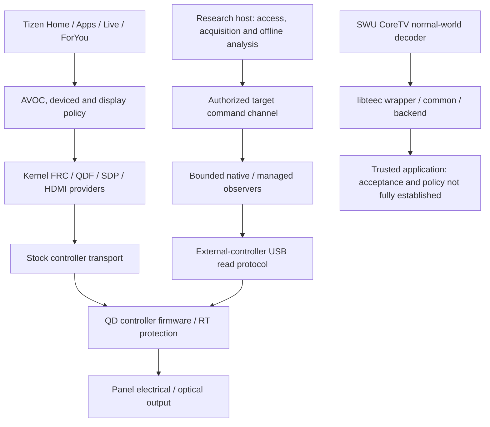

# Platform and function map

The arrows identify researched call or transport relationships. They do not prove a causal chain from a particular UI image to physical blackout. The external MCU, SoC MMIO, CPU addresses, bus windows and firmware load domains must remain distinct.

| Area | Concrete anchors | Boundary |
| --- | --- | --- |
| Access | Archive-root and host-assisted controller lifecycle; source modifications and e2e tests | Root availability is separate from reboot persistence and untethered boot changes |
| UI | Stock `/usr/bin/input_keyevent`, compositor D-Bus `org.enlightenment.wm.Test.EventKey`; managed Home / Apps / Terra components | Cached tab state does not establish focus or visible light |
| Display | AVOC panel mute, deviced policy, FRC/QDF ioctls, SDP registers, HDMI DPMS and AVMUTE | Successful IPC/ioctl and composited screenshots do not prove optical output |
| USB observer | Fixed read windows R/M/C/H/L, exact 12-byte OUT header followed by matching IN | Single USB owner; accepted OUT must receive its matching IN before any next OUT |
| Ordinary RT predicate | Stored image-1 caller around `0x1e68..0x2040`; aggregate at CPU `0x2000d0e4 + 4*i`; `low16(A[i]) > selected_fp`; fault literal `736 / 0x2e0`, reported fault 1001 | Retained tail execution does not recover missing operands at the comparison |
| Source map | Held table `0x584109a4..0x58410aa4`, four lanes of 16 unsigned words | Runtime writer, PrePD units and any DMA ownership remain unresolved |
| Callback lifecycle | Descriptors 8 and `0x1c`; teardown disables callbacks | Source-proven lifecycle is not observed runtime restoration after a fault |
| SWU / TEE | `TEEC_Context` 4 bytes, session 4, shared memory prefix 36; target operation requires at least 60 bytes, including backend word at offset 56 | A generic 56-byte operation is unsafe for this implementation |
| Header decode | First record `[1,2,1,2]`; full-byte parameter types; metadata-only commands 0 / 1 / 2 | No command-3 capture fallback belongs in the isolated metadata helper |

The detailed instruction excerpts, symbol maps, reproducers and independent reviews remain in the [research tree](research-map.md). See the [evidence rules](evidence-and-methods.md) before applying a map from stored firmware to a live image.

## Authenticated extraction architecture

The [CZ phase index](../research/panel-idle-20261026/overnight/firmware-extraction-workbench-20261028cz/README.md) maps official acquisition, authenticated OUIT metadata, per-section ciphertext RSA, bounded native streaming, pinned TLS quarantine, and original-byte validation. [The final update](firmware-extraction-20261028.md) records all nine actual results and the platform rejected-driver/offline-reconciled-receipt distinction. The kernel/DTB findings remain stored-image and candidate-board evidence, not executing-text/live-tree identity or a blackout root cause.

## Content-sensitive source and evidence graph

The [integrated firmware guide](firmware-evidence-guide-20261028.md) connects exact AVE scene/NPC dispatch and controller sends to the separately proven image0 AP_EXCO selector bridge. The FRC-to-AP_EXCO data-field edge and physical RTP aperture producer remain unknown. The [machine graph](../research/panel-idle-20261026/overnight/firmware-evidence-graph-20261028dg/addenda/graph-with-dh-onset-02.json) preserves address domains, original source hashes, static/inferred/unknown distinctions and negative controls. Packaged identity, actual controller observation and emitted light remain separate layers.
