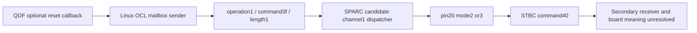

# Controller firmware formats and address domains

The platform extraction contains several controller assets, not one interchangeable firmware image. The source maps below are useful for format analysis, disassembler setup, mailbox matching and bounded instruction oracles. They do not attest active fetch, flashed contents or a physical reset domain.

## QD package: two Thumb domains and shared state

The selected 5,242,880-byte QD package has SHA256 `bad60bca4d6064406f14e53da3528d46701ec9c81673f4323db1937f6a2017e0`. **Image0 file offset = VA+0x200; image1 file offset = VA+0x40200.** Equal numeric CPU addresses in two cores are not sufficient to establish shared ownership. Use the qualified getters, root seed and aliases rather than an assumed common load base. [GX](../research/panel-idle-20261026/overnight/rtp-fault-clear-paths-20261028gx/README.md) shows the specific shared-root relationship and initializer evidence.

Image0 scatter row9 initializes the shared RTP root, including stop0/fault0/ordinary0. Image1 local startup BSS instead contains the N ordinals/counts and other local state. Thus initializer0/0/0 is not operational clean0/0/1, and local N0 is compatible with a still-faulted shared root. [GY](../research/panel-idle-20261026/overnight/menu-fault-rearm-design-20261028gy/README.md) and [HD](../research/panel-idle-20261026/overnight/ap-emergency-unwind-design-20261028hd/README.md) trace the separate emergency consumer and output/init obligations.

[GV](../research/panel-idle-20261026/overnight/rtp-input-buffer-producer-20261028gv/README.md) closes the selector and software copy chain. Image1 `18ce0` returns one of three slots based on a byte index and zero/nonzero tag. Image1 `18ae8` copies descriptor-selected aperture regions using the actual CPU copy routine; `3934` prepares descriptors from old scratch/new filtered samples. This establishes a software dataflow, not the physical sample producer or a shared input epoch. The exact slot/header/payload extents and finite instruction-oracle qualifications are in the report and source audit.

## OCJP multipart candidate and word transform

The extracted 901,120-byte `PMDMICOM_OCJP.bin` candidate has SHA256 `61754d8e0445ed1a73685af83cdcf3fea66971b1a622b04c3f614b8b63286aff`. [HE](../research/panel-idle-20261026/overnight/ocl-reset-receiver-map-20261028he/README.md) maps the loader/candidate components; [HG](../research/panel-idle-20261026/overnight/ocl-mailbox-system-dispatch-20261028hg/README.md) checks the coherent SPARC view by reversing each four-byte word in memory. No transformed OEM image is distributed here.

| Format check | Candidate source result |
| --- | --- |
| Source-format checksum | Adler32 of the word-reversed prefix through file offset0xdbff8 matches stored little-endian0xce93f188 |
| Legacy uImage header | File0xf000, header64 bytes; payload0xf040..0x3bc20, length0x2cbe0 |
| Header/data CRC | 0x7afe4346 / 0x05f82b60 |
| Declared load/entry | Both0xa0020000; linked code address =0xa0020000 + file offset −0xf040 |
| Declared kind | OS5, architecture10, type1, compression0; name `fw_sys.uimg` |
| Dispatch tables | All82 absolute pointers in the three examined tables map aligned into the declared payload |

These source integrity checks establish consistent format and mapping, not OEM trust, active firmware identity or board equivalence. The available installed candidate/module hashes are metadata corroboration. Filename selection/override paths and currently flashed bytes remain distinct.

## Linux OCL → candidate mailbox → secondary command

HE proves the Linux sender's one-byte reset argument and metadata word `0x00013f01`; conditional configuration selects direct-AHB or I²C mailbox transport. HG proves a candidate channel1 operation1 table entry, command3f entry and actual delay-slot behavior: nonzero input calls pin20/mode2; zero calls pin20/mode3. That handler does not check the returned secondary result. Its callee packs STBC command40 into `0x40140200` or `0x40140300` and writes the secondary mailbox. Reply kind/command checks are not a physical reset acknowledgement. Fragment readiness, bus byte-lane behavior and the current fragment index remain protocol premises.

The source contains a real secondary receiver boundary. Pin20/modes2/3 must not be named a rail/reset electrical operation solely from Linux's exported function name. Neither the handler nor a new USB number proves image0 scatter initialization, instruction RAM reload or emergency-loop exit.

The [HG QDF context addendum](../research/panel-idle-20261026/overnight/ocl-mailbox-system-dispatch-20261028hg/reviews/qdf-callpath-context.md) also explains a misleading printk function label: text naming `m_set_elvdd_onoff` can be emitted inside `m_set_power_control` callback branches. The literal label alone does not establish an alternative call path. Optional resolver binding and currently loaded runtime state remain separate.

## Using the corpus

Instruction addresses, candidate file offsets, module section offsets, CPU roots and bus aliases are always labelled in the retained reports. Original source hashes and bounded span hashes permit independent reacquisition. OEM firmware, kernel/vendor libraries and emulator/native dependencies are not included; annotated excerpts, original audits and finite source-oracle code are retained. See [source lineage](source-lineage.md), [reproduction](reproduce.md) and the [fixed-cutoff guide](firmware-controller-20261028.md).
