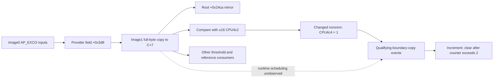

# Controller reference refresh and observability

This checkpoint adds a source map for selector refresh, fixed-reference copying and lane-table lifetime, together with a bounded logging design and independently replayed observations. It extends the controller workbench beyond the blackout case: the reusable methods are integer-width models, explicit state and timestamp boundaries, selective retention of already-read bytes, and independent classification of rejected collectors. It establishes no prevention fix, instruction hook or physical-output measurement.

The completed [record/score checkpoint](rtp-records-20261028.md) and [sampled-code checkpoint](code-fingerprint-20261028.md) remain separate evidence. The former contains two unchanged-limit40 faults and a later inconclusive reversible40→200→40 comparison. The latter matched four16-byte code samples; it does not attest the later refresh, trainer or gate bodies discussed here. Whole executing-image identity and historical comparator execution remain open.

## Source map: selector, mirrors and reference copies

[EJ's selector-origin audit](../research/panel-idle-20261026/overnight/selector-origin-20261028ej/README.md) connects the image1 callback/dispatch path to an existing image0 AP_EXCO provider. Image1 copies a **full byte** from provider+0x3d8 into its context+0x6c7. Context getter0x38f4 returns CPU0x20000500, making the local selector CPU0x20000bc7, already captured as C+7. The copied byte is not normalized to a boolean by that image1 store. The upstream selected image0 producer calculates a boolean from two independent input conditions; its physical data producer, units and contemporaneous inputs remain unresolved.

The source has several distinct mirrors. The selector-copy function publishes a zero-extended halfword at RTP root+0x24ca. Another handler compares C+7 against the u16 mirror at CPU0x200004c2. A changed nonzero selector seeds u16 CPU0x200004c4 to1; a changed zero clears it. An unchanged selector does not rearm it. A separate byte mirror at CPU0x2000045d participates in another consumer. Agreement in a later sample is not an event timestamp or proof of atomic ordering among these functions.



[EG's refresh audit and pure model](../research/panel-idle-20261026/overnight/reference-refresh-control-20261028eg/README.md) show the boundary-copy entry conditions: nonzero refresh counter, nonzero C+7 and a qualifying current B header. Row0 takes the top branch; otherwise row height−1 takes the bottom branch. The code copies2912 bytes from B+8 and increments the u16 counter. A value greater than2 is cleared. The dispatcher skips ordinary comparison while the counter remains nonzero.

**The seed counts two qualifying boundary events, not two distinct buffers.** Starting at1, top/top, bottom/bottom, top/bottom and bottom/top all satisfy the bounded model. The source contains no recovered “one top and one bottom” test. This does not establish that normal scheduling ever supplies a repeated boundary, that an actual reference was stale, or that this mechanism caused a fault. Interrupt races, stable-input assumptions and the copy implementation remain outside the pure model. The syntactic literal/access scans are bounded source censuses, not complete reachable-writer proofs.

## Lane eligibility is published state with a lifetime

[EC's full lane-table audit](../research/panel-idle-20261026/overnight/rtp-lane-table-writers-20261028ec/README.md) supersedes the earlier unverified trainer lead. Training entry requires **u16 CPU4a2 == 1**. CPU4aa controls a separate category dispatch and is not that trainer gate. The earlier [immutable correction](../research/panel-idle-20261026/overnight/rtp-lane-table-writers-20261028ec/training-gate-correction.json) remains retained beside the full audit.

The primary table owns all16 bits. Its proved publishers combine a secondary byte with twice a u16 counter, truncating the result to16 bits. The comparator's local primary condition tests bit0, but the higher bits retain counter-derived information. Secondary flags are sticky on the inspected training path; out-of-band counts accumulate across nonconsecutive samples and wrap before threshold comparison. Record reset does not itself clear these counters and flags. Different startup/runtime paths initialize or clear different regions; a successful stock recovery does not prove that an arbitrary later diagnostic write would be restored.

For a lane that execution reaches, the recovered local permission formula is:

```text
(primaryHalfword & 1) == 0 && (secondaryByte == 0 || SB)
SB = (AA == 1 || AC == 1) && byte4cc != 0
```

An earlier comparator can terminate the loop before a later locally permitted lane is reached. These logical lanes have no established physical-pixel mapping. Neither table is disposable scratch memory or an independently qualified safe protection-bypass interface. EC includes a narrowly framed future diagnostic discussion; it implements no write helper or completed intervention.

## What the observations add

| Evidence | Observed result | Scope limit |
|---|---|---|
|[ED baseline analysis](../research/panel-idle-20261026/overnight/rtp-lane-gate-trial-20261028ed/live-analysis/README.md)|Accepted16 read pairs/32 bulks; all68 primary words and secondary bytes zero, SBfalse; clean start/end R at40|Captured local permission, not comparator calls, historical table state or physical pixels|
|[EE warm unchanged40 analysis](../research/panel-idle-20261026/overnight/lane-gate-onset-20261028ee/live-analysis/README.md)|Accepted80 clean DP checkpoints; maximum sampled A0=24; later accepted EB again found both68-entry tables zero|The software fault did not reproduce in this warm control; no treatment or prevention effect|
|EE post-read timing|Last completed DP read to first EB header216.406480s|Separate observations with a measured gap; no simultaneous table/score assertion|
|[EH first-read refusal classification](../research/panel-idle-20261026/overnight/refresh-checkpoint-trial-20261028ei/refusal-analysis/README.md)|Native first R already faulted;8 matched read pairs/16 bulks,0 clean cycles/checkpoints and no Left child; Ready/released/closed; wrapper refused native exit1|No new synchronized onset, no key-caused fault and no accepted EH trial|

ED/EE zero N and X/Y/RGB columns do not make nonzero B/Diff remnants a current valid record prefix. A source-conditional A reconstruction must not be made from those remnants. Earlier valid-prefix/fixed-bottom findings remain evidence for their own retained observations, not every later capture.

The EH refusal is especially useful for experiment design: cached Apps UI state was insufficient to establish a clean controller baseline. The logger correctly withheld Left and retained its original failure. The separate classifier validates the unchanged original receipt and command history; it does not repair the wrapper into success or forge an accepted projection. The coordinator subsequently reports exact nine-file cleanup with no extra vendor request, a separate accepted EB fault snapshot16/32, one guarded stock MODE2 recovery, and a separate accepted EB validation16/32. The latter has clean0/0/1 at40, zero reported N/latch fields and sampled tables, and zero fixed-reference candidate windows; its exact stage was removed. Recovery creates a new USB instance within the same Linux boot. These are separately coordinated observations and do not retroactively qualify the EH onset. The [frozen independent replay](../research/panel-idle-20261026/overnight/refresh-checkpoint-trial-20261028ei/fault-table-analysis/README.md) passes1744 checks normally and with `-O`, rejecting222 malformed cases against251 pinned inputs and reproducing56 mock commands. Raw follow-up receipts and identity-bearing decoded output remain excluded; the [sealed parent phase reports](../research/panel-idle-20261026/overnight/refresh-checkpoint-trial-20261028ei/validation-preparation-note.md) retain the reported boundary. No optical observation is inferred from either cached UI state or the RT tuple. No threshold/table/code/kernel/boot/flash change was made in this sequence.

The separate fault snapshot has41 coordinate-bearing entries. Under explicit same-epoch/type1/12-bit-input premises, their unique nonnegative A=B+Diff candidates all match the later bottom reference and differ from the later top:1827 at lanes570/571,3045 at624/625,1712 at632/633. N source counts are zero, and persistent B/Diff tail remnants remain. This is conditional compatibility, not a proven current prefix or historical branch. The first EB header follows the last EH IN by404.280869s; this interval is neither an onset bracket nor immediate capture. H's42 score belongs to the earlier EH sample; EB does not read H.

Independent recovery validation shows clean R at40, latch0 and all N ordinals/counts zero, zero sampled gate tables and zero104-byte fixed-reference windows. B remains nonzero while X/Y/RGB/Diff clear. This qualifies a sampled state/reference reinitialization, not all-RAM clearing, original-instruction reload, all-domain cold reset, optical repair or a rollback guarantee for future modifications. [EI's chronology](../research/panel-idle-20261026/overnight/refresh-checkpoint-trial-20261028ei/findings.md) preserves the rejected onset, exact cleanup, fault snapshot and separate recovery as distinct operations.

## Retaining more of existing reads

[EH's logger and reviewed layout](../research/panel-idle-20261026/overnight/rtp-refresh-checkpoints-20261028eh/implementation-report.md) preserves DP's exact R,M,C,P,N,H,L,R order and one-Left workflow. It appends20 bytes to the existing34-byte checkpoint: six u16 fields from M+2/+4/+0x22/+0x24 and **end-R**+0x60/+0x6e, plus the two u32 dynamic-pointer words at P+4/+8. No extra controller read or write is introduced.

The54-byte layout required a separately labeled15-second cooperative budget and at most60 rows, with the same250ms nominal cadence. It is not equivalent to the old20-second/80-row DP observation. The adversarial complete receipt is24,250 bytes including newline,326 bytes below the unchanged24,576 cap. Exact source, prefix, offset, counter and malformed-receipt tests accompany the implementation and independent review. Root45s/host75s limits and2-second per-bulk timeout remain; there is no inherited native40-second alarm.

These taps retain source-directed history that DP discarded. They are still sequential reads. M precedes P and end-R; only the original H full request/reply bracket is stored compactly. A sampled pointer establishes no pointed-to header, alias, epoch or historical active branch.250ms polling can miss the entire refresh sequence. Zero in every sampled counter is not proof that the copy function never ran. No execution hook, owned executable scratch, instruction-cache/install safety or deterministic hook rollback has been qualified.

## Reusable investigation method

Use [EF's pure coordinator design](../research/panel-idle-20261026/overnight/rtp-cold-control-design-20261028ef/README.md) as a reviewable state-machine model, not a deployed controller. Its receipt and clock-domain rules distinguish source qualification, a completed matched read-pair boundary, cached readiness and actual observations. A source-proven field or branch is a logging target; it is not proof that the function executed in a recorded interval.

For later work, qualify a clean controller baseline before any synchronized UI action; record the actual last completed IN and first subsequent header; preserve current-versus-historical record validity; retain selector/counter/pointer state across the transition; and separate native acceptance, enclosing workflow acceptance, cleanup and recovery. Keep monotonic and wall-clock domains explicit. A refusal or ambiguous short transfer is a stopping boundary, not permission to replay a key or issue a blind reset.

Pure models run from a fresh public clone without OEM binaries or private credentials:

```sh
cd research/panel-idle-20261026/overnight/reference-refresh-control-20261028eg
python3 -B -m unittest -v test_refresh_model
cd ../rtp-lane-table-writers-20261028ec
python3 -B test_lane_model.py
cd ../selector-origin-20261028ej
python3 -B test_model.py
cd ../rtp-cold-control-design-20261028ef
python3 -B -m unittest -v test_coordinator
```

Repeat with Python `-O` to exercise explicit guards. Source audits and actual-capture replay additionally require the retained private, hash-pinned acquisition inputs and original layout; publication does not claim those run on a fresh clone. Existing scientific fixtures remain unchanged. [Publication policy](publication.md) excludes raw OEM images, code samples, auth/device/binding receipts, actual private configuration and identity-bearing decoded outputs. Original source/reviews, sanitized reports and the pure models remain reusable under their recorded license scopes.
