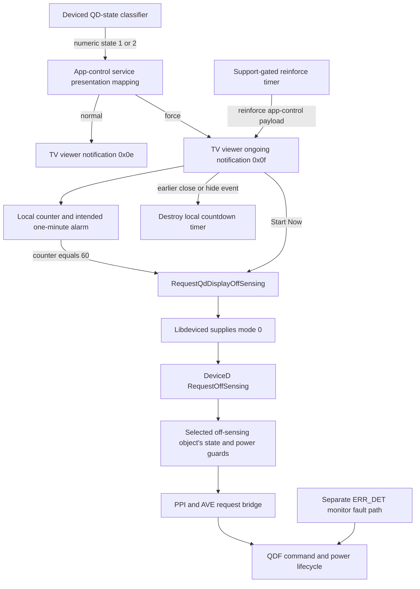

# Automatic Screen Optimization: reconstructed path and remaining repair boundary

Status at2026-10-26 13:53 UTC: the installed warning text, intended countdown,
automatic request, producer policy and lower service mode are reconstructed.
They are not yet causally aligned to an owner-observed sparse-menu blackout.
The investigation made no notification, sensing, power or factory-setting
change in this pass. Current physical picture state is unobserved.

## Reconstructed architecture

The arrows are recovered software capability paths, not a record that all ran
during a particular blackout. The diagram deliberately separates the warning
from the hardware-fault monitor; a missing software frame or a repeated
QD_TCON_OFF history log cannot choose between these causes.

## Exact warning and expiry

The US/GB gettext catalogs resolve the owner's clearer-screen/automatic/
ten-minute off-on wording. The key is referenced by the force/reinforce
receiver in the matching native executable. Notification0x0f is ongoing
type1, and its local alarm is configured with1000/60. Each callback increments
the counter; the display formats60-counter. At60, code deletes/cleans up the
notification/timer and converges on the off-sensing request wrapper. This is
the automatic edge even without a Start Now event. Exact elapsed wall time
under live scheduling is not measured by static code.

The explicit button calls the same wrapper separately. Event cases1/100/101
take close/hide/timeout accounting and timer destruction without a direct
request. This proves their local cancellation path; it does not guarantee
ordering against a callback already due/in flight. The callback's return1 is
not assigned an unsupported alarm-return contract.

The wrapper invokes the no-argument `qd_display_request_off_sensing`, whose
provider explicitly supplies mode0 to `RequestOffSensing` at
`/Org/Tizen/System/DeviceD/Display`. The integer service reply is checked and
logged; the local UI wrapper returns void. A logged request or zero reply
still does not prove that a gated QDF command reached the MCU or that the
panel emitted light.

Sources: [resource match](../idle-research/tv-viewer-optimization-resource-match.md),
[notification path](../idle-research/tv-viewer-automatic-sensing-notification.md),
[expiry flow](../idle-research/tv-viewer-off-sensing-timeout-flow.md).

## Producer policy and time units

The app-control service maps enum1 to normal-off-required,2 to force-off-
required,3/4 to off completed/canceled,5/6 to EL completed/failed, and7 to
force-EL-required. Its startup GLib callback runs the initial classifier on
the sixth delivered callback, not inside exported `Init` itself. That query
can acknowledge saved results; the investigator did not manually invoke it.

Reinforce is another producer route, gated by the adaptive-off-sensing
feature. Its timer constructor defaults to172800seconds (48hours). A positive
persistent `db/tv-viewer/reinforce_off_sensing_time` overrides that with
value×60seconds; missing/nonpositive retains the default. A change to the
memory cancel key triggers another callback, which ignores the event's value
and rereads the same persistent time key: positive value×5seconds, otherwise
14400seconds (4hours). Therefore setting this persistent time to0 is not an
all-warning disable switch.

The reinforce timeout also checks its power API result and software-upgrade
status. It may defer/set a reminder flag, or write status2 and launch the
reinforce payload. These effects are not passive getters and were not called.
See the [producer trace](../tcon-research/app-control-off-sensing-producer.md).

## Actual passive values and limits

| Observation | Retained result | Interpretation limit |
| --- | --- | --- |
|13:29 reminder-key reads | pending flag false; reinforce time0; cancel count0; force-EL count0 | Stored fields, not a global disable or live timer/popup state. |
|13:35 maintenance-key reads | off result0; EL result4; off time1789; EL time5752; off count6 | Raw Int32 values; not current hardware state or a measured cycle. |
|13:41 factory service | item200802, label Offsensing TEST Period, value0; BIP getter0 | Named factory DB key absent, so displayed0 may be fallback. |
|13:48 process identity | app-control PID1519/start2667ticks; tv-viewer PID427/start253ticks; CLK_TCK250 | Starts10.668s and1.012s into this boot. Not a trace of later callbacks or timer rearming. |
|13:48 software-upgrade stored status |0 | A stored value at that read, not proof of every producer branch's history. |
|13:53 selected vlog read | no matching warning/request strings; vlog reported278837 emitted lines | Pattern selection using recorded `-t3600`; no continuous onset or global absence conclusion. |

All reads share recorded boot `00000000-0000-4000-8000-000000000000`.
The root socket remains host-assisted. None of these observations confirms
whether the physical panel is currently lit. The exact raw filenames are
listed in the phase evidence manifest and central index.

## Fix candidates and unresolved cause

The stock factory period's value6 has a daemon disable predicate. Follow-up
resolved its real driver selector16 and statically paired UID-specific receiver: AVE's
FRC/TCON branches are no-ops for UID0x506e; the diagnosis receiver returns-95,
but TIFS discards that return. Its status/skipSaving path can therefore reach
factory UID storage. A hardware-effect conclusion cannot be taken from the
generic function name or a discarded callee error. No factory test was
performed; reload, all-route coverage and originally absent-record rollback
remain unresolved. See the [factory audit](../tcon-research/factory-off-sensing-test-period.md)
and [transmit follow-up](../tcon-research/factory-off-sensing-transmit-target.md).

The automatic UI request edge is now a precise software target for an observed
intervention, but no native file/runtime patch is prepared or deployed here.
The main repair still requires an aligned physical transition with this
notification lifecycle, real command traffic, monitor fields and fault logs.
The [power implementation](../tcon-research/qd-power-control-hardware-sequence.md)
can misreport cached-on state after lower failures; the
[physical timeline](monitor-latch-physical-timeline.md) shows the old monitor
latch around already visible Apps. Neither mechanism alone proves the cause.
