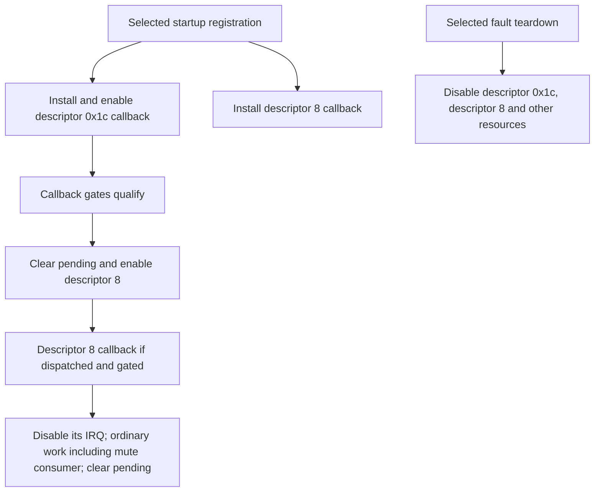

# Callback identity and the dependency of ordinary re-enable on dispatch

Recorded 2026-10-27 UTC. All work in this pass is offline. The TV's last
vendor transaction remains BB's accepted primary-log read; no target command,
new collector, interrupt change, power action, firmware write or flash was
performed here. No physical picture observation is available.

## What changed in the fault model

The [descriptor reconstruction](descriptor-identity.md) makes the selected
package identity more precise: descriptor 8 is initialized with IRQ 39 and
pointer `0x58220024`. The selected IRQ-39 vector wrapper passes descriptor 8
to its installed callback. That callback's bit-3 gate therefore reads the
word reached through that pointer, rather than a separate RAM object's bit.
These are packaged initializer/vector facts, not current live RAM or IRQ
measurements.

The [ordinary enable trace](reenable-trace.md) finds a second source edge:
descriptor `0x1c`'s callback can clear pending and enable descriptor 8 after
its own gates qualify. Descriptor 8's own callback disables its saved IRQ
before ordinary work and clears pending at completion. Normal disable alone
therefore does not establish an abnormal stuck state.

The fault-teardown dependency is essential: body `0x96d8` disables descriptor
`0x1c` **as well as** descriptor 8. Thus a positive ordinary enable edge does
not show that its owning callback will still be dispatched after teardown.
No source-only claim of either permanent disable or automatic post-fault
recovery follows. Actual later dispatch, another enable path, interrupt
state and hardware behavior remain unobserved.

This diagram describes conditional selected-code paths. It does not describe
an observed physical blackout or establish a self-recovery loop.

## Corrections made during review

Root checked the ordinary enable branch against its actual fault-teardown
dependency, rather than treating existence of an enable instruction as proof
of post-fault restoration. Root also checked the PC-relative literals in the
state gates: the branch reads byte `0x2000087c` twice; a later zero store uses
the separate byte `0x2000087e`. That store must not be described as clearing
the gate byte or proving an alternating callback cadence.

## Consequence for the next experiment

The source model now distinguishes ordinary callback handoff from the fault
teardown which disables both resources. It still does not identify a proven
prevention parameter or justify forcing an interrupt on. A fresh physical
visible/black state paired with a fresh accepted RT observation remains the
next live discriminator. Old AV clean RT and a later owner answer cannot be
treated as simultaneous measurements.

If a later experiment observes a received ordinary mute request, keep its
setter, pending state, consumer attempt and physical response separate. The
existing unchanged W reader covers the pending word; the existing primary
log reader can retain positive setter/consumer text if still present. No new
combined low-level collector was implemented or proposed here.

## Validation

Root independently decoded the initializer using the existing pinned decoder
and disassembled the vector wrapper, mute callback, ordinary enable branch,
enable helper and fault teardown. Separate agents supplied bounded source
traces and independent review. Normal and optimized local verifiers check
the descriptor/source identities and positive lifecycle edges. Their exact
results and final artifact hashes are retained in `validation.json` and
`evidence-manifest.json`. Passing source checks establish neither current
execution nor a repaired panel. The blackout-prevention goal is incomplete.
