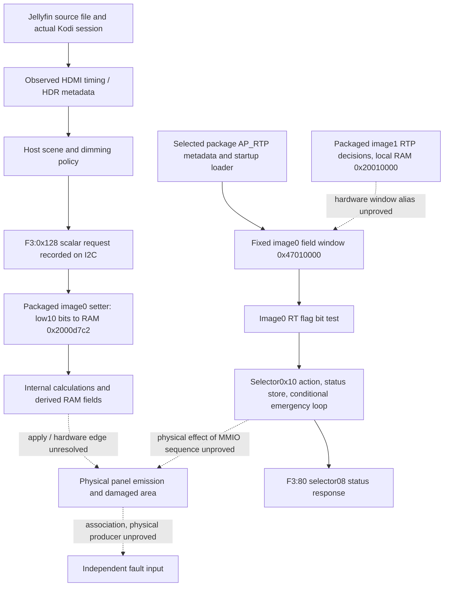

# Panel blackout: evidence and unresolved links

Updated2026-10-27 UTC after the failed PROGRAM_LABEL and working PROGRAM_A captures.
This map is a navigation aid, not a complete firmware reconstruction or proof
that an entire causal chain has been established.

The diagram's solid controller edges describe recovered packaged code. They
are not a claim of complete live-controller byte identity or proof every path
executed during the incident. The HDMI-to-host arrow describes the stock
software route; it does not prove timing alone caused a fault.

## Strong live discriminators

**Later recovery-path experiment:** one stock operation41/mode2 off-then-on
request produced observable ACDET/reset-mailbox/USB/I2C replay activity.
Pre-action ERR_DET1 became0; immediate and approximatelyfive-minute later
sequential status/pin samples were0/0, same Linux boot. There is no physical observation
after this action. The whole60-second observer record is rejected for a
pre-action AVOC syscall-pair failure; the independently decoded transport
substreams remain narrowly useful. See the
[transport audit](sleep-investigation-20261027a/stock-mode2-transport-audit.md)
and [sequence audit](sleep-investigation-20261027a/mode2-sequence-runtime-audit.md).
This associates a bounded stock reset/re-enumeration with changed reported
samples and warrants a physical-picture check. It establishes neither
controller latch semantics nor prevention. No repeated reset loop was installed.

| condition reported by owner | accepted follow-up status | accepted independent pin |
| --- | --- | --- |
| populated Apps visible | 0 | 0 |
| For You persistent black | 0x10 | 1 |
| Ugoos menu visible | 0 | not sampled |
| PROGRAM_LABEL persistent black, audio continuing | 0x10 | 1 |
| PROGRAM_A playing visibly | 0, matching raw QDF kernel row | not accepted; complete raw helper output0 is supplemental |
| program_b running, then owner reports black | first0 before latest report; separate after-report0x10, both matching raw QDF rows | accepted after-report1 |

These are sequential observations on the same Linux boot, not synchronized
electrical captures. The original HDMI trace records remain rejected for
AVOC heap-boundary changes; their raw kernel/I2C evidence is analyzed within
that limit. Physical owner reports and exact entry-time limits are retained.

## Explanations weakened by actual controls

- Repeated CLEAR_AVMUTE is not black-only: it also occurs during visible
  Ugoos-menu operation at approximately24Hz.
- The historical host QD_TCON_OFF flag is1 during both good and black cases.
  It is bookkeeping that skips the monitor's fresh checks, not a continuing
  command that by itself explains physical black.
- The issue is not confined to empty Home pages: actual Kodi playback of
  PROGRAM_LABEL also produced the status0x10/pin1 signature.
- A broad file-format explanation is insufficient: user-reported working
  material spans several formats, and completed history includes a Person of
  Interest PROGRAM_LABEL with the same broad source format as PROGRAM_LABEL. Historical
  playback flags are not independent physical-success observations.
- An HDR-activation-only explanation does not follow: the failed source is
  SDR, and working PROGRAM_A negotiates HDR10+. Output transitions still need
  controlled comparison.

## Productive next discriminators

1. PROGRAM_B was subsequently rearmed explicitly and tested. The
   owner reported running playback then black; a first status0 before the
   latest report was followed by separate after-report0x10 and independent
   pin1. No calibrated onset was captured; its original trace remains
   rejected for an AVOC maps change. Old HOLD preparation stays excluded.
   A future onset recording needs enough time after an owner GO to cover a
   delayed failure and must retain the original physical timing limits.
2. Trace controller application of the staged duty field through its derived
   values; avoid equating a RAM store with a completed physical drive change.
3. Resolve the live RT producer / image1-to-image0 window connection. AP_RTP
   initialization provenance is now known for the selected package, but the
   runtime bit transition is not.
4. Finish mapping the host direct-IO UART receive path to determine whether
   the controller's diagnostics have an observable host receiver. No TTY was
   opened or mux changed; dynamic-probe interfaces checked so far are absent.

The opening ten seconds of PROGRAM_LABEL has near-black encoded SDR luma. This
fits a content lead worth testing, not a proof that low luminance triggers
RT protection or a reason to change undocumented thresholds.

## Supporting reports

- [Overlay/fullscreen paired-control evidence](ugoos-overlay-paired-control-20261027.md)
- [Two-week owner-confirmed content controls](ugoos-researcher-two-week-controls-20261027.md)

- [Failed versus working HDMI comparison](ugoos-PROGRAM_A-comparison-20261027.md)
- [Requested profile history](ugoos-researcher-history-comparison-20261027.md)
- [Source-frame sample](ugoos-source-luminance-comparison-20261027.md)
- [AP_RTP load and defaults](../tcon-research/qd-config-rtp-table-load.md)
- [HDMI CLEAR_AVMUTE source](../tcon-research/hdmi-clear-avmute-loop-boundary.md)
- [Controller scalar write dispatch](../tcon-research/qd-f300-write-payload-dispatch.md)
- [Controller scalar consumers](../tcon-research/qd-final-duty-controller-consumers.md)
- [program_b actual-test comparison](ugoos-program_b-comparison-20261027.md)
- [program_b actual-test evidence index](ugoos-program_b-20261027a-evidence-index.json)
- [Controller write-gate producers](../tcon-research/qd-f300-write-gate-provenance.md)
- [Generic read-command ABI](../tcon-research/qd-generic-read-command-abi.md)
- [RTP primary-event inputs](../tcon-research/qd-rtp-primary-event-input-provenance.md)

No firmware/protection/kernel patch or permanent fix has been deployed.
