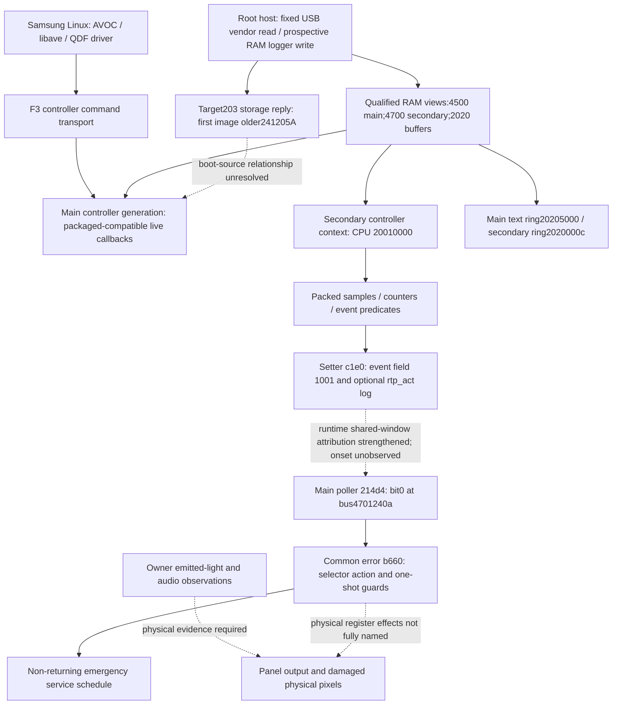

# Reverse-engineering map and evidence boundaries

Recorded2026-10-27. Linked addresses below use FILE=VA+0x200 for image0
and FILE=VA+0x40200 for image1. Physical RAM bus addresses receive neither
file bias. Dashed edges are unresolved behavior or runtime attribution.

## What is established

- Host error-status getter and QDF raw log have been reconstructed and
  exercised. Old status0x10 and new status0 occurred at different times.
- Main callback RAM exactly matches the newer selected initializer; the
  complete5MiB storage reply has an older first image. Neither observation
  selects every executing byte or identifies boot source.
- Secondary bus470004e0 exposes the exact reset-derived root20010000 plus
  plausible nonzero runtime gates/bounds. This materially strengthens the
  formerly missing CPU2001/shared4701 relation. The core tag is unobserved.
- Main and secondary text buffers are directly readable in2020 SRAM. Main
  captured text is active and ordered by copy sequence; secondary cursor5/5
  and flag0 show consumption, not event absence.
- The error handler can permanently replace ordinary main scheduling after
  its actions and guard mismatch. A current PC or incident-aligned invocation
  is not captured. Continuing persistence logs cannot distinguish its service
  loop from ordinary scheduling, because both call that persistence service.

## What the next instrumentation targets

The existing image1 formatter is gated by context+2406 bit0. Its firmware-native
writers preserve the other bits and restore saved state. The proposed finite
RAM-only experiment requires fresh0000, verifies0001, observes bounded logger
activity, and restores0000 only at known protocol boundaries. Unknown partial
USB phases must stop traffic; release/close does not abort the device parser.
No writer or logger-gate change has yet been deployed.

An owner-observed new onset is still needed to connect the lower event
predicate, host policy and actual OLED darkness. The physically damaged spot
and vertical line are reported facts, not repaired by any software work here.
