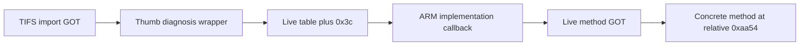

# Live diagnosis-backend identity: bounded pointer capture

At2026-10-26 14:58:02–14:58:03UTC, three read-only stages captured the missing
factory diagnosis-backend pointer chain. The capture invoked no factory
function, getter, setter, D-Bus method or driver operation. It was physically
unobserved and is not a recovery test. Concurrent daemon activity is not
excluded by this non-atomic endpoint capture.

Raw evidence: [factory-backend-runtime-20261026T145801Z.json](factory-backend-runtime-20261026T145801Z.json).
All stages retain TIFSDaemon PID1085/start1203, boot
`00000000-0000-4000-8000-000000000000`, exact executable and library source
hashes, load biases, and matching before/after maps. The maps also match
across stages. Recorded uptime interval is48291.75–48292.61.

## Actual pointer chain

| Link | Observed value |
| --- | --- |
| TIFS diagnosis import GOT0x165924 |0x47590fd9, Thumb wrapper in libvideo-misc |
| Wrapper global at0x475a3048 |word0=0x100, word1/table=0x012d5980 |
| Table+0x3c at0x012d59bc |0xf4bb70e4, ARM callback in mapped implementation |
| Implementation load bias |0xf4bab000 |
| Callback relative address |0xc0e4, video_system_diagnosis_set_factory_item_impl |
| Instance global0xf4bca00c |0x012d58e8, aligned readable heap |
| Method GOT0xf4bc9e9c |0xf4bb5a54, implementation-relative0xaa54 |

The wrapper's first word is reported as a raw nonzero guard value; it is not
assigned an unsupported handle/type interpretation. The concrete method's
UID0x506e unsupported return and the caller's discarded-error/status flow
remain instruction-level analysis, not an executed factory request.

## Integrity and limits

[snapshot-factory-backend.py](snapshot-factory-backend.py) is dry by default.
It derives the wrapper-global address from the paired getter instructions,
binds the ARM PLT0x2808 to relocation index15/GOT0x1ee9c and the method symbol,
and verifies source SHA, architecture, root/model, PID/exe/start/boot, mappings,
pointer repetition, read ranges and executable targets. Source-file hashes
are not hashes of running instruction pages. A lazy or unexpected GOT/table,
changed map/process, unreadable singleton or short read is retained as a
failure; no function is called to initialize or resolve it.

The stages read20bytes then24bytes, exactly44total. Raw base64 decodes to
repeated globals plus the observed callback pointer; all dd counts and root
transport results passed. Seven offline fixtures cover valid metadata/full
chain, PID reuse, source mismatch, map change, unmapped pretransport refusal,
and short-read rejection/raw retention. They do not contact the TV.

Read-only reviewer `runtime_reader_review` reviewed the reader, identified
missing PLT/GOT and singleton-range guards, then cleared their fixes and all
seven fixtures before the single live read. It independently decoded the
completed raw result and confirmed all44bytes, identity/maps/hashes and the
pointer chain. `accepted:true` is justified for that bounded observation.

This supersedes only the prior diagnosis-backend pairing gap. It does not
prove the VE backend's contemporaneous guard outcome, a factory storage write,
readback/persistence semantics, coverage of every maintenance route, current
OLED emission, or the cause of the sparse-menu blackout.
