# From firmware assets to the blackout mechanism

The exact main firmware is now fully extracted and validated, but the causal mechanism and permanent prevention remain open. The strongest narrowed software path is the ordinary mode-1 RTP aggregate comparison: captured score0→38→44 against selected limit40, action bucket0→3→7, then stop1/fault0x1001/gate0. The physical producer of those counts and the final electrical light-suppression edge are still unresolved. This guide prioritizes firmware/source and logging work before another parent-controlled menu baseline.

The user has authorized autonomous investigation. No owner response is a prerequisite for the software observations below. This document implements no device action; the parent alone coordinates fixed finite target helpers and UI/recovery blocks. For new unattended samples, report physical visibility as unobserved. An existing owner report remains attached to its original incident; neither it nor a compositor image becomes a new optical measurement.

## The case a fix must explain

| Case | Established evidence | Qualification that must survive |
|---|---|---|
| Populated native Apps / moving saver | Repeated owner-visible control; some accepted sequential status/pin clean samples | Cached Apps and screenshots alone do not establish emitted light |
| Sparse native Live / ForYou | Repeated owner persistent-black reports while audio/menu activity can continue; CB accepted RT transition and separate blackout report | CB physical instant is not inside a measured250ms optical bracket |
| HDMI failureA fullscreen | Owner persistent-black report; later accepted stockstatus0x10 / faultinput1 | Original broad HDMI observer rejected; narrower accepted readers remain distinct |
| HDMI failureB fullscreen | Separate failure context with later accepted0x10 / input1 | Initial status0 is not a calibrated visible baseline or physical-onset timestamp |
| Same failure playback behind UgoosHome | Could remain visible after TV restart, then fail again fullscreen | Same playback is not an identical final HDMI frame/composition; exact historical output mode is not known for every control |
| Working movie/series controls | Owner explicitly confirmed ordinary viewing across several formats | A server played flag is not physical confirmation; failure diagnostic plays are excluded from successful controls |
| Rare brief picture/audio interruption | Owner describes self-recovery, sometimes with audio pause | Separate uncaptured symptom family; do not force it into persistent RT fault mechanism |
| Pre-existing impact damage | Owner report and photos corroborate local bottom-edge defect and vertical line | Does not identify the initiating circuit or prove all persistent loss is physically generated at the spot |

Private viewing titles are represented by stable failure/control case IDs here. The broader working set weakens a blanket SDR/HDR, codec or framerate explanation. The paired UgoosHome context is a useful composition/content control, not proof of a particular dimming branch. Any proposed mechanism must account for both failing fullscreen cases, their Home controls, working movies, and native sparse-menu behavior without silently assigning the rare audio-pause incidents to the same cause.

## Evidence ladder and address domains

1. Official archive/ZIP and main section interval integrity establish acquired bytes. CE/CF establish authenticated header representation/tree and section ciphertext signature scope relative to the pinned installed key. Nine plaintext sections passed exact size, strict padding and original-byte CRC. This does not install firmware or establish full applicability policy.
2. File/package identity establishes the selected asset. CS proves declared stored kernel equality; DF supplies the exact selected QD package inside official factory content. Neither is a whole executing-kernel/controller hash.
3. Selected-image disassembly supplies static functions, fields and comparisons. Image1 VA, file offset, CPU data address, controller-bus view, DT physical MMIO resource and Linux virtual address remain separate domains. A name/number match is not an alias proof.
4. Accepted native samples supply software bytes, transfer order and timestamps under their protocol freshness/phase premise. The R/M/C/H/L windows are sequential, not atomic registers frozen at the predicate call.
5. UI caches and compositor images describe software composition; owner testimony or independently qualified optical measurement describes emitted light. Unattended software trials can succeed without asserting physical success.

The source-backed predicate at selected-image1 VA0x1e68..0x203e selects mode1 when aa=0/ac=2. C+7 nonzero selects the finite40 field; zero selects normal200. It rotates four-count history, updates aggregate A, applies T and compares low16(A)>limit. Equality40 is clean. Formatter counts qualifying lanes; s is a count, not measured amplitude, luminance, current, temperature or another proved physical unit. The record-ID publication bound can saturate while counts continue to grow.

At VA0x2030..0x203a, a crossing ORs bit4 into the mode bucket and calls the common setter with event736. The setter at VA0xc1e0 writes the stop/fault/gate tuple. CB's mode/bucket/score/gates support this edge under running-source stability assumptions; it did not record event736 itself. Alternative transient gates, indirect writers or a different executing image are not excluded. Clearing bucket+0x2486 does not prevent this comparison: it is output history, not the enable mask.

A compatible history model goes A38→40→40→44 even when the new final s is zero, because delayed history contributes an older count. This explains why logging only the last lane difference or current count could miss the decisive aggregate. It is a model consistent with sequential samples, not a uniquely reconstructed event trace.

## Positive source bridges and the remaining missing edges

DF's separate [cross-core addendum](../firmware-rtp-producer-20261028df/cross-core-slg-addendum.md) closes the source of the selector. The selected image0 AP_EXCO data object is CPU0x2000ff14. Writer VA0x2fb44, with stores at0x2fb60..0x2fb76, sets context+0x3d8 to `((data.u8(+0xe6)&1) | data.u16(+0x2fc)) != 0`. Context is CPU0x200158a8. Image1's mode0 named-resource directory resolves this context through the source-proved SRAM translation+0x25000000, so its remote read is0x45015c80. The image1 reader mirrors that byte into C+7, selecting alternate-limit/fixed-A branch conditions. Image0's next change handler logs `slg-on/off`; the short label is established, an expansion or electrical meaning is not. The whole running image0 remains unqualified. Mode0 remote0x4501.... must not be substituted for the mode1 local0x4700.... capture windows.

This is a positive inter-core source chain. It does not yet identify the upstream writer of data+0x2fc, the semantics of data+0xe6 bit0, or the physical producer feeding0x60000000. The separate image0 PrePD0x584109a4 source remains an unproved bridge; names or similar addresses do not connect it to RTP.

DE's [display-path findings](../firmware-display-path-20261028de/findings.md) supply the Linux-side content route from the exact packaged/retained AVE asset. `QDDimming::t_vSyncCallBack` calls scene construction at ELF linkVA0x17b56e→0x1795d0. With the RoseMQD vtable active, scene dispatch at0x1797a0 uses slot0x70→0x1c6370; NPC dispatch at0x179836 uses slot0x154→0x1c72dc. Backend construction loads the packaged NPC JSON. A changed selected NPC index causes exactly16 controller sends at0x1c73aa..0x1c73e6. The request's changed `ScreenProtect` word+0x60 is delivered to FRC0x42618 through0x1c63fe. Those are source-backed control writes; they are not diagnostic suggestions or a proved blackout trigger.

These routes make content/composition-sensitive input plausible across both native pages and HDMI. The current missing edge is the actual propagation from those Linux/FRC writes into image0 AP_EXCO data+0xe6/+0x2fc and the packed producer. DE's later register-access addendum narrows callback/access indirection; current instance register-base identity remains open. An active backend/vptr or a current call was not observed just because the packaged symbols and vtable match. The graph retains the scene→AP_EXCO edge as `unknown`.

```mermaid
flowchart LR
  Scene[AVE scene and NPC classification] -->|static calls and active-vtable condition| FRC[FRC and16-send controller paths]
  FRC -. unknown register-to-field bridge .-> Data[Image0 AP_EXCO data e6 and2fc]
  Data -->|static writer2fb44| SLG[Image0 context3d8 SLG boolean]
  SLG -->|mode0 remote alias45015c80| C7[Image1 C+7]
  C7 --> Limit[Alternate40 and packed-A selection]
  Producer[Unknown physical aperture producer] -. unknown .-> Ring[Packed ring and lane counts]
  Ring --> Predicate[History aggregate comparison]
  Limit --> Predicate
  Predicate -->|source edge with event736| Tuple[Stop1 fault1001 gate0]
  Tuple -. electrical and optical bridge unknown .-> Light[Emitted light]
```

Solid arrows above are selected-source dataflow, not a claim that all edges executed during CB. The conditional threshold explanation and the content-sensitive negative controls remain hypotheses to test together.

## Known menu/recovery sequence and automatic classification

The operational route is Apps/header context, ordinary Up, Up, then one Left to cachedLive; sparse Live/ForYou is the known fault-producing context. CB's synchronized recorder itself sent only one Left after separate header preparation. BW additionally used another Left to ForYou. Do not describe all preparation keys as if CB recorded them inside the same synchronized interval.

A future parent-controlled baseline can use this known finite route with the existing reviewed single USB owner/ReadyForHeader contract, actual cached page checks, fixed capture windows, exact transfer counts and no retries. If the desired starting UI/identity/phase is absent, classify a precondition refusal rather than sending blind fallback keys. Capture one full clean set before the trigger and retain last clean/first fault/post-fault samples. Preserve the independent down/up return times; a returned key call is not compositor receipt.

| Automatic outcome | Required evidence | Meaning |
|---|---|---|
| Precondition refused | Identity/layout/USB phase/UI mismatch before dispatch | No onset experiment began |
| Accepted clean observation | Complete finite transfers, identities/counts/cleanup pass; retained R stays0/0/1 | No software fault observed in this finite interval; no claim of light |
| Accepted software transition | Same protocol checks plus fresh retained R0/0/1→1/0x1001/0 | Software onset observed; timestamp bracket conditional on reply freshness |
| Already faulted | Initial retained R1/0x1001/0 | Not a new onset; do not relabel subsequent UI actions causal |
| Transport/lifecycle rejected | Short read, timeout, stderr, identity/phase/count mismatch or ambiguous completion | Preserve original rejection and records; no automatic resubmission |
| Native recovery completed | Fixed stock helper returns exact expected ioctl/close/lifecycle receipt and cleanup | Controller operation completed under its contract, not optical recovery |
| Recovery software clean | Separately qualified fresh post-operation RT/status sample meets its own clean contract | Software recovery state observed; distinct from native operation completion |

The established recovery route selects cachedApps by normal Right navigation, then one unchanged stock operation41/mode2 after its existing public-state/identity checks. It is a distinct operational block after the observer has closed USB and saved evidence. No post-reset key, automatic reset loop or unknown-phase packet is part of that route.

CB's owner reported light back on Apps, but its recovery wrapper rejected a proc-exit race despite narrow native rc0/ioctl0/close0 and confirmed cleanup. That rejection remains. BW is a separate accepted operational recovery with owner-visible Apps and later kernelstatus0. Those kernel values are not raw MCU RT tuple reads. A new unattended trial records its own software results without requesting or assuming owner verification.

## Logging placements before another experiment

Prefer the smallest source-backed observation that closes a specific edge. A getter name does not prove passivity. No new GPIO request, debug override, MMIO access, logger setter or controller code patch is implemented here.

| Placement | Bounded facts to retain | Question resolved / technical limit |
|---|---|---|
| Existing R bracket | Stop/fault/gate, bucket, selected limits before/after | Software transition anchor; not atomic physical onset |
| Candidate0x4700ba28/36 | Six u32 record IDs followed by six u16 current s counts | Separate ID publication saturation from continuing count generation; fixed reader/phase must be qualified |
| Candidate0x47000490/16 | Selected A/B pointer context | Which packed branch was selected; no payload semantics inferred merely from a pointer |
| Existing H/L plus C/M | Aggregate/history/q/T latch, flags and selector beside R pairs | Distinguish history contribution/threshold selection; later samples must remain later |
| DF source boundary | AP_EXCO resolver→resource+0x3d8→C+7 and descriptor/ring copies | Close cross-core selection provenance while preserving unknown physical aperture writer |
| DE display/AVE boundary | Source/scene/NPC/dimming cached operands and call sites identified by exact module identity | Bridge composition to delivered scalar/input candidate; no callback invocation or write implied |
| Native final receipt channel | Fixed bounded dedicated receipt separate from runtime logs | Prevent GC/status byte interleaving; platform DA refusal/reconciliation is the concrete negative case |

A newly extended reader needs exact fixed length/address fields, independent protocol/failure checks, sole ownership, bounded duration and known terminal phase before use. A software logger that writes the controller ring changes timing/state; read-only windows and actual callback ownership must be qualified first. `vlog_set_ops` is a routing mutation and micom version helpers actively transact; neither is passive logger discovery. DT GPIO/resource maps do not qualify live register reads.

The separately frozen [DF eight-window candidate](../firmware-rtp-producer-20261028df/capture/README-wrapper.md) now implements R/M/C/P/N/H/L/R, with a seven-read M/C/P/N/H/L/R post set. It has host source/layout and integration qualification, including matching-IN failure cases, strict count/length checks, a single USB owner and one Left worker; see [independent review](reviews/df-eight-window-review.md). Its initial host-only prototype is a different snapshot. No device outcome for the new windows is asserted by this guide; the first exact-length P/N reply is still an observation to retain, not an assumed premise.

For existing AVE history, the coordinator qualified the finite reader `/usr/bin/vlogutil -v kerneltime -t 2 '*:S' 'AVE:I'`. The accepted historical baseline had two old monitor latch messages and no physical observation; it does not establish a fresh power action. Preserve the driver's `not_complete:4` diagnostic despite complete root transport. [DE's logging plan](../firmware-display-path-20261028de/capture-recommendation.md) separates unchanged producer gates from reader filters: selected-NPC change messages and ScreenProtect-change messages are already in normal source paths; repeated NPC logging requires a backend debug bit and is not enabled here. `AVE:I` cannot bypass `vlog_is_allowed`/initialization/priority gates. A quiet two-second history may miss a transition or a producer rejection. Use the exact finite reader's existing bounded child contract rather than extending it into a stream, and preserve the complete selected output before host string filtering.

The next useful timestamp alignment keeps each Linux monotonic row, controller transaction bracket, key subprocess interval and cached page interval separately. VLOG formatting is millisecond precision; footer time and advertised interval are not individual event times. Existing filtered GPIO/IRQ tracepoints can only observe stock calls/interrupts that actually happen; debug ownership metadata is not a pin value and a stale monitor may make no getter call at all. New GPIO requests/direction changes, probes or a global trace replacement are not implied by static DT/module analysis.

## Next root-cause experiments

The frozen DE/DF source chains are integrated in the graph with per-contribution hashes and original anchor metadata. Continue at the missing field/transport bridge and producer writer rather than treating a symbol match as causal closure. Distinguish official asset equality from running-image identity. The physical0x60000000 producer, selected A/B branch, exact live field units, and image0 PrePD0x584109a4↔image1 RTP bridge remain explicit unknowns until a positive dataflow proof exists.

The two small read windows have a frozen host-qualified finite helper; the next device result is centrally coordinated under its own fresh phase/identity contract. Use the known autonomous menu sequence as a baseline only after technical preconditions pass. The discriminating result is whether count production, record-ID publication, history A/q/T and limit selection precede the first fault R in the source-predicted order. A post-fault latch that never changes can be historical, not causal. Preserve clean controls and samples that contradict the model.

For the HDMI branch, compare the same failing source under fullscreen and UgoosHome composition while retaining actual source/scene/HDMI mode identity and the software operand chain. This future paired test must not infer historical output modes from media metadata. The working controls should span the observed formats rather than comparing a single HDR working title with a single SDR failing one. Parent coordinates any playback/UI action; DG supplies the question and classification, not an executor.

The existing deferred finite40→200 RAM limit proposal is a narrow hypothesis test, not a repair. The same field also changes the record-ID publication bound, and source does not establish electrical safety or a universal reset restoration path. No writer was implemented. Blanket protection disable, changing C+7, or clearing output buckets cannot substitute for producer/timing evidence. If a future bounded RAM experiment is technically qualified, it requires its own exact one-field/readback/restoration contract and must still explain the HDMI and working-control phenotypes.

## Fix criteria and rollback criteria

A durable fix needs an explicit source-level mechanism that explains the full phenotype set; exact running target/layout qualification; a bounded reproducible before/after comparison; preserved clean controls; expected software predicate/input changes; no new transport, electrical or error path regressions; and a separately demonstrated recovery path. “Stayed on Apps”, “no fault during20s”, “threshold raised”, “status0”, or “screenshot nonblack” alone is not a permanent fix.

For unattended work, report finite software success/rejection immediately and continue independent offline analysis. Do not ask the owner to verify light. Physical efficacy remains a separate unmeasured claim unless an independently qualified optical observation is actually available; record that limitation rather than adding an approval gate.

Stop the current experiment on identity drift, unexpected tuple/mode, unknown USB phase, timeout/short transfer, ownership collision, unconfirmed termination, an unbounded output or any unexplained write/readback change. Preserve the original failure. Never send restoration packets in an unknown transport phase. Restoration, reset/recovery and subsequent baseline are separate fixed parent-coordinated actions with new qualified preconditions, not retries hidden inside an observer. No flash, permanent service, automatic recovery loop or arbitrary-address interface follows from this guide.
