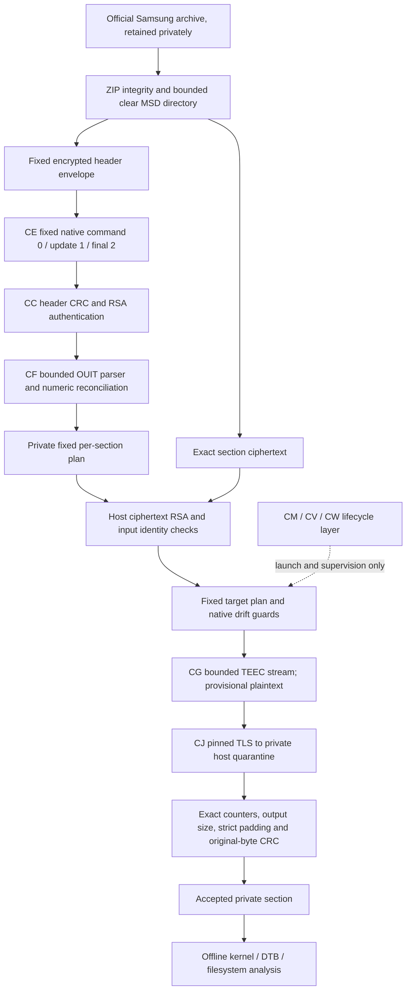

# Firmware extraction workbench — CZ phase index

All nine main-package sections have now been extracted and validated in centrally coordinated trials. Platform.img completed at 01:25:31 UTC. The original DA driver rejected interleaved runtime GC/status output; a separate bounded offline reconciliation recovered one unique native receipt and validated the GC framing without reinvoking TEEC. Payload length, strict padding, original-byte CRC, native cleanup and exact job/stage cleanup then passed. The original driver remains classified rejected. Earlier CR unsigned-script and CX script-hash refusals remain recorded. No firmware was installed.

This index consolidates authored code and derived findings for the exact Canadian QN77S95FAFXZC package, version 0090-1301.0. It contains no OEM binaries, decrypted metadata, salt/signature values, secret configuration, private content hashes, or keys. Private evidence stays in its original restricted directories. This phase checkpoint was prepared before publication; final release operations are recorded separately.

Read [phase-report.md](phase-report.md) for observed results, source-backed cryptographic scopes, launch failures, analysis limits, and next priorities. [evidence-index.json](evidence-index.json) records the local evidence locations and their roles; those references do not make private evidence publishable. [section-status.json](section-status.json) contains only section names, lengths, and validation outcomes.

## Architecture and trust boundaries

Header authentication, parsing, ciphertext authentication, native transport completion, and plaintext validation are distinct gates. The background lifecycle layer does not change the crypto engine or establish plaintext validity. Full firmware policy/applicability validation and the blackout root cause remain open. Read the platform receipt reconciliation in the phase report before treating native completion as an originally accepted driver result.

## Entry points

| Area | Authored evidence / code |
|---|---|
| Official acquisition and archive integrity | [Acquisition report](../../../firmware-acquisition-20261028/acquisition-report.md) |
| Header representation, CRC and RSA model | [CC authentication](../swu-header-authentication-20261028cc/README.md) |
| Actual authenticated header acquisition | [CE integration](../swu-header-target-20261028ce/README.md) |
| Full recognized wire tree and section parameters | [CF call map](../swu-item-schema-20261028cf/schema-call-map.md), [parser](../swu-item-schema-20261028cf/item_schema.py) |
| Bounded native streaming engine | [CG engine](../swu-section-stream-20261028cg/SectionStream.cs), [independent review](../swu-section-stream-20261028cg/reviews/independent-engine-review.md) |
| TLS quarantine transport | [CJ transport](../swu-stream-transport-20261028cj/README.md) |
| First small-item integration | [CI review](../swu-section-target-20261028ci/reviews/metadata-integration-review.md), [CK delta review](../swu-section-target-20261028ck/reviews/delta-review.md) |
| Actual five-item batch | [CQ results](../swu-section-batch-20261028cq/actual-batch-report.md) |
| Kernel identity, board DTBs and GPIO/MMIO distinctions | [CS analysis](../firmware-kernel-analysis-20261028cs/report.md), [bounded FDT parser](../firmware-kernel-analysis-20261028cs/fdt_bundle.py) |
| Current fixed platform native helper | [CX build report](../swu-platform-target-20261028cx/build-report.json) |
| Original lifetime source review and its limits | [CM review](../swu-stream-job-20261028cm/reviews/independent-lifetime-review.md) |
| Corrected preparation implementation | [CW job source](../swu-prepared-inline-job-20261028cw/job.py) |

This index records the final main-package extraction checkpoint, not a live execution dashboard. Frozen stage reports describe what each author had proved at that stage; later actual outcomes in this index supersede an earlier stage's statement that section plaintext was unavailable.
