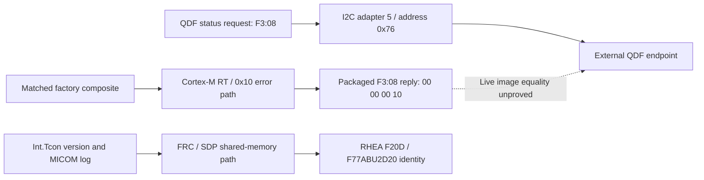

# Firmware/profile investigation, 2026-10-27

The previous continuation made progress by closing the SSB transport and
readback boundary. This continuation adds an independently checked profile
match, actual ordinary-file acquisition and a complete official package
member. No physical recovery or permanent prevention has been demonstrated.
Latest owner report remains panel off; machine records below do not observe
physical light. No new display, reset, protection, GPIO, controller, USB or
secure-world operation was performed.

## A uniquely matching panel-data candidate

The [new corpus audit](../tcon-research/qd-fault-next-discriminator-audit.md)
finds an existing raw runtime tuple that earlier reports overlooked:

```text
PANEL[77A3OUSOF]
FW[FA024C300/F:FA024C300]
MD[F77ABUAE20312300/F:F77ABUAE20312300]
```

Among the nine source-hashed factory files, only
`F_RSM1_BN9659934B_COMMON.bin` matches all three source-bound comparisons:
tail `FA024C300`, first-nine MD `F77ABUAE2`, final-five MD `12300`.
The intervening MD `03` remains unsourced. Forty-eight occurrences across
28 raw files contain the same tuple, including visible-Apps and black-related
capture sets; these are retained periodic lines, not synchronous observations
of each physical state. This selects a uniquely matching packaged candidate,
not proof of a file invocation, flashing, current controller byte equality or
fault causality. It is separate from the startup identity `F77ABU2D20`.

This supersedes prior report statements that no retained passive evidence
distinguishes the nine candidates. The exact CAD provider was already acquired
and is not still missing. Those older report versions remain preserved.

## The selected ordinary file is now copied

[Metadata](profile-and-swu-tools-metadata-20261027a/client.stdout), SHA256
`b3470c80b6cd42a5761c1ea7f2b33b6d84a46746e052225fbd0085a3a52ca156`,
confirms the regular non-symlink source is 5,242,880 bytes, SHA256
`bad60bca4d6064406f14e53da3528d46701ec9c81673f4323db1937f6a2017e0`.
Its deterministic gzip representation is 463,401 bytes. Boot stayed
`00000000-0000-4000-8000-000000000000`, uptime81485.59..81485.89.

First attempt [a](selected-qd-profile-copy-20261027a/chunk-00.client.stdout)
was rejected: its pipeline returned no chunk and reported gzip broken pipe.
The downstream `dd` stderr had been redirected, so its exact failure reason
is unobserved. Remote command status zero did not override the stderr/data
failure. No candidate output or successful manifest was accepted from a.

The deliberate corrected [b acquisition](selected-qd-profile-copy-20261027b/manifest.json)
uses byte-counted `dd` plus a pipe drain, avoiding short block reads and early
consumer closure. Fifteen sequential authenticated root responses each check
source size/hash/boot before and hash/boot after the read. All chunks match
their expected lengths; full decompression reproduces the original 5 MiB SHA.
The host now has the [complete candidate](selected-qd-profile-copy-20261027b/F_RSM1_BN9659934B_COMMON.bin).
No temporary target files, device nodes or controller transactions were used.
The [independent copy audit](selected-qd-profile-copy-20261027b/runtime-audit.md)
reconstructed all 15 raw responses and the full output. It accepts byte-copy
integrity, while noting per-call uptime/inode/mount identity were not sampled.

## Complete official main MSD acquired on the host

The original-author
[MSDU11 parser](https://github.com/hTobi02/TizenWLED/blob/020c7892c1ff37f13f0aa514ac9f0b1561a20bb7/tools/firmware/inspect_msd.py)
was retained at a pinned commit and inspected. Its clear-layout interpretation
was independently reproduced on our earlier exact Canadian-model prefix.
The clear-header stored CRC32 `1f54c22c` matches the 216-byte region after
the length field. Nine contiguous section ranges end exactly at the ZIP
directory's declared uncompressed member length. The section names/content
remain opaque; matching a size to another-region documentation is only a
hypothesis.

A bounded host-only HTTP request acquired the complete
`T-RSMFAKUC-0090/image/upgrade.msd` member, rather than only the earlier prefix.
[Result](external-msd-parser-20261027a/acquisition-result.json) records the
same official URL and ETag, HTTP206 and exact range512..1493773282:

| Check | Result |
| --- | --- |
| Compressed bytes |1,493,772,708 |
| Uncompressed bytes |1,493,538,434 |
| Whole ZIP member CRC32 |`a8e4a70a`, matches central/local headers |
| Uncompressed SHA256 |`790584c7a91391bc6e9964c8f1c4649c225d2f9e6aeffabfc5e58e8a64fb7fc3` |
| Prior 65,494-byte prefix |exact SHA match |
| Target TV operations |zero |

The corpus auditor independently streamed the local member and reproduced
size, SHA, CRC and clear layout. This verifies transport/member integrity;
it does not verify a Samsung package signature, decrypt any section, or show
that the package contains the matching external-controller executable.
The downloaded bytes were never sent to or applied on the TV.

## Cipher-only route: source reviewed, no session invoked

The [SWU feasibility review](../tcon-research/swu-decrypt-feasibility.md)
describes existing source for trusted-application AES initialization,
streaming and finalization. Its wrapper has no install/flash/reboot call, but
it changes secure-world cipher/session state and its exact installed ABI,
backend and authorization still require evidence. There is no implication
that a generic command number is universally safe or that a helper is ready.

Ordinary-file metadata now confirms `/usr/lib/libteec.so` 10,892 bytes,
SHA256 `926840c9e7b26c59d8cb9d4ab5ae274e62b11efdbf14831b0a4d81d3de720f70`;
the [exact library copy](libteec-copy-20261027a/manifest.json) independently
matches that hash from one authenticated response. It was not loaded.
Its [independent audit](libteec-copy-20261027a/runtime-audit.md) accepts that
byte-copy conclusion without inferring an executable ABI or access policy.
The existing encrypted-passphrase file's size/hash were recorded only;
neither its contents nor a plaintext secret was acquired. No TEEC context,
session, shared memory, cipher or trusted application was opened/invoked.
The [exact installed-wrapper analysis](../tcon-research/libteec-installed-abi.md)
now shows load-time initialization calls`dlopen("libteec_trustware.so")` and
resolves a generic TEEC forwarding table. Merely loading the wrapper is not
an inert metadata check. It contains no SWU UUID or command-specific policy;
the backend and TA behavior remain unbound. Further work on this route also
depends on proving which controller firmware actually produces RT Protect.

## Protection and maintenance remain distinct unresolved questions

The [additional telemetry inventory](../tcon-research/qd-protection-additional-telemetry.md)
finds no recovered ordinary getter that expands the RT subcause. Several
tempting status/temperature getters read caches; other paths are active
controller or engineering transactions. Older telemetry timing is insufficient
to exclude a transient at the later blackout.

The [primary-source evidence note](../tcon-research/rt-protection-external-evidence.md)
identifies the owner's ten-minute/one-minute-popup description as Samsung's
documented OLED maintenance, while leaving the internal RT label undefined.
Samsung's public guidance does not equate the two mechanisms or document a
clear command for the observed0x10 word.

Actual fault attribution still needs aligned visible-versus-black evidence,
or recovery of the real controller-side protection implementation. The new
profile match and acquired bytes make that investigation more specific;
neither constitutes a tested repair or a reason to apply an asset.

## Further result: executable RT-protection code and corrected controller layer

The [actual candidate-content analysis](../tcon-research/qd-selected-profile-content.md)
finds two high-confidence Cortex-M/Thumb images in the copied 5 MiB file,
alongside parameter/LUT banks. It is a composite, not calibration data alone.
Image 0 has coherent vectors/startup, a`S6TUT14FW` banner and image identity
`241230A`. The image identity and package/runtime tail`FA024C300` remain
distinct strings; no version-encoding transform or current-flash equality
is asserted.

Image 0 routine 0x99e8 performs a four-byte EEPROM-labelled read at address 0xe0,
checks signature/history/gate/count state and enters the common error handler
with selector 0x10 and exact literals`EEPROM Check RT Protection` and
`EEPROM Check RT Protection Max count`. The error entry calls a dedicated
0x10 dispatch and a setter that stores the selector in the low 16 bits of an
object field at +0x10. A direct initialization call reaches this routine.
These are concrete packaged producer-side instructions, not a name-only
correlation, but their execution during the owner's fault is unobserved.
No EEPROM value, repair threshold or writable remedy is established.
The [independent producer review](../tcon-research/qd-profile-rt-producer-independent-review.md)
decoded these branches and verified both 0x10 calls, the selector-field store,
dedicated dispatch and coherent init caller. It additionally notes the error
entry normally enters a repeated-handler loop unless two magic halfwords
match; this is static behavior, not an observed crash/reboot diagnosis.

The [runtime log-field trace](../tcon-research/qd-runtime-profile-log-fields.md)
also establishes that QDF generates the profile record by querying four
I2C-addressed fields: nine-byte FW buffers and sixteen-byte MD buffers.
The complete runtime MD, including`03`, originates in the query buffers;
the meaning/file-layout provenance of`03` is still unknown. `/F:` is not
expanded or treated as proof that a factory pathname was opened. That log
chain does not open or parse the CAD file.

The separate [controller-identity audit](../tcon-research/qd-rt-controller-identity-boundary.md)
closes a crucial earlier assumption. QDF FW/MD reads and the RT-status
transaction share the external QDF path, adapter 5/address 0x76. Internal TCON
version retrieval instead traverses the FRC/SDP extended-command route to a
shared version table; the RHEA MICOM log is another region of that same
internal resource. This proves distinct software transports and identities,
without claiming separate physical chips. It does not make the RHEA 2 MiB
image the external RT-status producer. Pursuing that image as the next RT
target was therefore an unproved layer assumption; the matched QDF composite
is now the better source-backed direction.



The subsequent [wire analysis](../tcon-research/qd-profile-rt-status-wire.md)
and [independent wire review](../tcon-research/qd-profile-rt-wire-independent-review.md)
close that static edge in the packaged image: the EEPROM RT check enters
the 0x10 error path, the common setter stores 0x0010 in object halfword +0x10,
the I2C decoder recognizes`f3 80 00 00 00 08`, selector 8 loads that same
halfword, and the transmitter emits`00 00 00 10`. The host's already
reconstructed byte reversal exposes 0x00000010. The selected read handler
does not clear/store the field in this image.

The RT branch also performs real MMIO writes and EEPROM counter/history
updates plus an eMMC-write path. It is not merely a printf. The individual
MMIO blocks are not bound to physical rails/resets here, and no writable
value is presented as a remedy. The EEPROM check's direct init caller is
not itself evidence of a live sparse-menu trigger; upstream runtime producers
and persistence effects are being traced separately.

Current flash-to-file equality, source-field lifetime and incident execution
remain unproved. This is now an end-to-end packaged-code explanation of the
wire status, not a verified initiating fault or physical fix. No controller,
EEPROM, firmware, protection or display command accompanied these offline
discoveries.

## Live trigger versus persistent history

The [live-producer census](../tcon-research/qd-live-rt-protection-candidates.md)
finds 35 coherent direct calls to common error entry 0xb860 in image 0. Three
explicitly pass 0x10: the two initialization/EEPROM branches and a live
poll at 0x216d4. The latter reads bit 0 of byte`0x4701240a` via the fixed
base getter 0xf194, logs`RT-P activate!`, and enters the 0x10 handler.
Its caller is inside the recurring main loop, so this is a real live
trigger check, distinct from the pre-loop saved-history checks. The writer
and physical meaning of that flag remain unresolved.

The 0x10 handler can increment a counter and write/verify its mirrored bytes
at EEPROM address 0xe0. Initialization subsequently consumes those saved
bytes. Thus stored history can feed back into error entry; it is not merely
a passive diagnostic log. The exact incident count, current values, counter
lifetime and physical initiating condition have not been observed. No count
was cleared, no EEPROM read/write was issued and no retry was triggered.

The [second-image RTP trace](../tcon-research/qd-profile-rtp-image 1.md)
finds scan/mode tests, absolute-difference thresholds and local event/state
updates. Matching offset+0x240a in that image is not automatically the same
address or runtime object as image 0. Image 0 uses fixed base 0x47010000;
image 1 dereferences a runtime pointer. A shared-memory or image-handoff edge
must be demonstrated before joining those graphs.

The [35-selector read inventory](../tcon-research/qd-profile-readonly-rt-state-selectors.md)
finds no existing F3:80 getter for the EEPROM-related fields. It also shows
selector 9 clears a separate field after reading it; therefore the adjacent
command numbers cannot all be treated as passive reads. No extra selector
or MMIO read was attempted. A separate ordinary-register transport question
remains under source review.

That review is now [complete](../tcon-research/qd-profile-open-register-read-route.md)
for the ordinary F3/D0/FE routes: F3:00 is a finite logical-selector map;
D0 exposes five bounded arrays; FE profile-version reads return four fixed
RAM arrays. None is a generic 0x4701xxxx memory window or exposes the RT
history fields. This prevents treating a truncated internal address as a
valid diagnostic command. The [separate F7 review](../tcon-research/qd-profile-f7-read-boundary.md)
now finds only three finite TX responses: protocol byte-sum, a status byte,
and a bounded action-response RAM buffer. Its receive family contains active
actions/MMIO writes. It supplies no proved RT-history or firmware-checksum
read path. No new query has been sent.

The [image-handoff review](../tcon-research/qd-rtp-image-handoff.md) likewise
retains the unresolved bridge: no static initialization or handoff proved the
image 1 runtime pointer equals image 0's fixed base. Exact-word/pointer scans
do not exclude computed initialization, scatter loading, boot arguments or
external writers. Equal offsets are not sufficient evidence.

A public search found a previously indexed Samsung Semiconductor S6TUT14
product URL matching the image banner's part-like token. Direct retrieval of
the [former Japanese part URL](https://semiconductor.samsung.com/jp/display-ic/dtc-soc-tcon/part-number/s6tut14/)
redirected to the general site, while the corresponding English path returned
404. Cached search text is not a recovered register-map datasheet or proof
of the fitted chip. No pinout, voltage or physical meaning is assigned from
that lead.

Next source target: trace block-copy/loader/configuration provenance for the
fixed image-0 RT window and determine whether the named`AP_RTP` packaged
parameters actually populate the live flag/gate/threshold fields. Matching
names alone will not be used to select a control value. That work is still
offline; physical fault prevention/recovery remains unverified.
