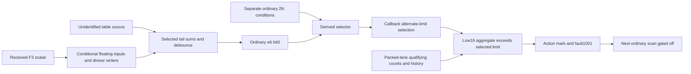

# Current ordinary-controller fault model — 2026-10-27

This is a working interpretation, outside the frozen evidence manifests. It
links the strongest results without promoting source-code hypotheses to
physical observations. The owner permits protection changes and flashing if
needed, with the requirement that the TV not be bricked. Permission is not
the missing input; executing-image/address qualification and event-time
measurements remain incomplete. No permanent fix or autonomous root is claimed.

## Latest operational result: Apps selected before stock restart

BU adds a third owner-confirmed recovery: actual normal local key navigation
selected Apps, one unchanged stock MODE2 controller lifecycle ran, and the
owner saw Apps return and stay visible, then a visible screensaver. The
preceding BT restart with For You selected did not visibly recover light.
This supports content-at-recovery as a testable factor, but does not distinguish
an immediately recurring fault from a failed physical recovery in BT.

Direct AppControl request success did not mean Apps was selected. The verified
key route uses the stock Tizen input_keyevent script and checks the cached
page after every bounded step. A 150 ms down/up pair produced normal focus
and tab changes while the physical panel was black. See the
[runbook](../../RECOVER-PANEL.md), [BU](apps-selected-panel-recovery-20261027bu/),
and [normal-key evidence](ui-navigation-20261027br/). Earlier pending statements
about leaving a For You screensaver are historical and superseded here.

The requested full Apps/For You/recovery cycle passed in
[BW](full-confirmation-20261027bw/findings.md): cached For You and owner-observed
black, two Right keys selecting Apps, one stock MODE2, then owner-observed
visible Apps. This is the fourth owner-confirmed physical recovery overall. No fresh raw controller RT sample or permanent
prevention is established by the new operational trials.

## External research update

The [external research project](../../research-20261027-external/README.md)
adds exact-target ABI and firmware-directory results, with independent byte
checks. Both BPF/perf ABIs in the saved kernel use ENOSYS stubs; RGB sampling
is a distinct host-FRC MMIO path with no recovered bridge to the external
Pre-PD producer; and the installed SWU client now supplies a target-specific
metadata-decryption call map. Its corrected helper prototype has host-only
tests, not a live binding. These results improve instrumentation/acquisition
planning without identifying onset operands or the final physical fault.
The [gap register](../../research-20261027-external/GAPS-AND-EXPERIMENTS.md)
retains those missing edges and the proposed fixed-tab content experiment.

## Owner-observed problem

The damaged panel has a thumb-sized black region at its bottom edge and a
narrow dark vertical band above it. Populated Apps often keeps the picture
visible. Sparse For You or Live can make the panel go black while the TV and
audio remain active. Once that persists, navigating blindly back to Apps
usually does not recover light; rebooting and quickly reaching Apps often
does. The owner also saw the screen saver remain visible after Apps was
populated.

Ugoos/Kodi playback supplies an independent content test. PROGRAM_04 PROGRAM_LABEL
and PROGRAM_B episode 1 have produced persistent black while audio
continued; after TV reboot, those titles could keep playing behind Ugoos Home
with the picture visible, then fail again fullscreen. PROGRAM_A's Farm, PROGRAM_08,
PROGRAM_09 and many watched titles have worked. These observations support a
content-dependent output condition. They do not by themselves identify a
video codec fault or locate the damaged circuit. Rare brief losses with audio
pausing and recovering remain a separate incident pattern.

## BH/BI: owner-confirmed recovery, paired clean state and recurrence

The [BH owner-paired trial](owner-paired-recovery-20261027bh/findings.md)
starts with owner-observed black and a freshRT1/0x1001/0. One stock MODE2
controller off/on is followed by the owner seeing the screensaver without
pressing a button. After narrow lifecycle/cleanup review and fresh USB
metadata, a delayed unchanged X run reports80clean cycles over20s, with
RT0/0/1 in the retained final cycle. The owner confirms the screensaver is
still visible. Linux did not reboot. Physical recovery is now demonstrated;
its precise instant and exclusive mechanism are not.

The owner later presses Home: For You appears for about1s, then persistent
black returns. A subsequent direct read is faulted again. The intended20s
Home observer ended clean and the actual keypress is not proved inside it;
no onset operands were captured. The late mode1 aggregate44 and alternate
limit40 fit one reconstructed branch. Initial faulted mode1 history was
instead zero with a different shared mode4/6 action bucket. Neither snapshot
uniquely identifies the faulting mode.

The [BI separately guarded repetition](owner-repeat-recovery-20261027bi/findings.md)
again yields a visible screensaver, confirmed by the owner. Status0x10->0
and error input1->0 are observed, with USB48->49 on the same Linux boot.
Its collector fails export integrity and the MODE2 PID has one failed
F3:01 read/ret-6 within its own replay. No subsequent vendor read is eligible
from this bracket, and none was performed. This negative evidence is not
erased by physical recovery or the other346successful action transfers.

Two ordinary AppControl requests later return and clean up: the original
switch-page-only request and a separately reviewed fixed Apps-key request.
The owner still sees screensaver and cached tab remains For You after each.
Apps consumption/foreground display is unproved. See the
[Apps-key trial](apps-key-trial-20261027bm/findings.md). Preserve the visible state
before any further navigation. No firmware patch, flash, protection bypass
or autonomous reset loop was deployed. This is a repeatable recovery
observation with known recurrence, not a preventive repair. Historical
AV/BD observations below remain physically unobserved in their own windows.

## What was actually captured

During finite V6 logging, the controller fault halfword changed from zero to
0x1001. The retained text contains 31 detailed RTP rows followed by two
rtp_act_736 strings. The ordinary setter logs once through two print sites,
so two strings are not evidence of two separate panel reboots. A subsequent
stock status query produced kernel output0x10 (RTProtect), and a later fault
input read returned1. That particular host-query record does not prove the
underlying controller transaction; it must not be promoted to a direct raw
controller sample. All were on one Linux boot.

The owner was asleep for V6. No physical light observation exists for that
interval, and the For You launch request was not proved consumed by the UI.
The capture therefore identifies a real controller event but does not alone
prove the physical blackout began at that event.

A fresh read at uptime124639.19 on the same Linux boot returns exactly the
same64context and256RT bytes as the earlier117834.25 capture, including
fault1001 and latches54/44. The snapshots are113.4minutes apart. This supports
retained state without proving continuous immutability or the event-time
comparison. A generic host `QD tcon status [OK]` and HSM0 coexist with this
directly sampled RTfault; those messages do not establish physical recovery.
See [fresh state observations](current-host-health-20261027v/findings.md).

## AV: a stock lifecycle followed by clean RT state

The [executed AV experiment](stock-rt-lifecycle-trial-20261027av/findings.md)
adds a faulted-to-clean sampled software-state comparison. A fresh unchanged
X read at136101.80 returned stop1/fault1001/gate0, matching all six retained
windows of the older X. One stock MODE2 then positively reached its lower
reset/GPIO callbacks, USB disconnect/re-enumeration and346complete I2C
transfers. Traced status replies changed0x10→0, independent fault input1→0,
and selector0x128 remained256. Linux stayed on the same boot.

After independent lifecycle and cleanup audit, one unchanged post-X ran
536.016seconds after the I2C tail. It reported80clean cycles over about20s,
480reads/960bulks, TimeLimit, terminalReady, release/close and absent stage.
Only cycle80 raw bytes were retained; prior79clean cycles are summary. Both
retained R samples independently decode stop0/fault0/gate1. This is a delayed
software-state change across a stock lifecycle, not an observed immediate
transition or proof that the lifecycle was the exclusive cause.

The original AVOC observer remains rejected for an orphan ioctl exit. The
independently qualified kernel/I2C subchannel does not rehabilitate it. No
physical picture was observed. Later ordinary UI context reports cached Apps
and mapped screensaver windows, not a known failing For You/Live transition.
There is no basis yet to claim recovery, prevention or a permanent repair.

The new reset-domain audit finds no recovered OCL receiver edge proving which
core or RAM MODE2 resets. Image1's scatter does not itself clear its RT root
object; image0 has a separate possible clear route whose execution is not
observed. Selected and older stored image1 slots are byte-identical, including
the setter defining these three RT offsets. This supports layout compatibility
between those two sources without proving active boot-source selection or
whole-code identity. Neither USB enumeration nor a delayed sample establishes
reset chronology.

The stock operation is associated with delayed clearing of the sampled RT
tuple and is a candidate to test for physical recovery with owner feedback.
First establish whether light is present before power/navigation changes,
then acquire a fresh RT observation while that physical state is confirmed.
A dark panel with concurrently clean RT would disprove a simple equivalence
between that record and current darkness; a later answer cannot establish
this using AV's older window alone. No automatic reset loop was installed;
all collectors and helpers have terminated and cleaned up.

## AW: selector and ordinary-input differences

The [AW follow-up](stock-rt-state-delta-20261027aw/findings.md) compares the
saved AV windows and adds one unchanged W read without changing UI, power or
controller parameters. R changed at12bytes; its known limit candidates and
aa/ac selector words stayed the same. C+7 and its mirror changed1→0, so the
conditional mode1 limit source changes from stored40 to stored200. Mode1
history/aggregate cleared, while a shared mode4/6 latch remained nonzero
(54→48). This is selective dynamic-state evolution, not a whole reset proof
or an isolated configuration rewrite.

The later W snapshot, terminal137706.50, matches live pointer gates and
returns ordinary e6=0/2fc=0, derived3d8=0 and derived bytes3/8. Older AK had
e6=1/2fc=0, derived3d8=1 and3/10. Both snapshots have the same ca/cc/ce/gate116
values1/1/0/1, P comparison values, index fields3/3/3 and6/6/6, caps6/6/6,
multiplier900 and threshold30. The saved recomputed sum mirrors instead fall
from8,254,590/8,251,261/8,250,967 to31,868/21,738/35,229; counter e2 changes
30→0. The selected-source restricted condition any(Pi<Xi) is true in the
older snapshot and false in the later one, consistent with both sampled
outputs and the derived Boolean. This adds a negative-condition comparison
to the earlier positive case.

W is about13minutes after the last retained clean AV R, and provides no
current RT measurement. Its fields are sequential, selected image0 meaning
is conditional, the source table itself is unobserved, and the units,
producer, cadence and causal relation to displayed content remain unknown.
Source-model consistency is not a record of the callback running. The next
content comparison should focus on these inputs and their counter/output,
with physical annotation and fresh RT state. A later owner black-screen
answer cannot be joined to AV's older clean window as a simultaneous
counterexample; that requires a new concurrent read.

## AX: limits of the source and host-log leads

The [offline AX follow-up](prepd-source-followup-20261027ax/findings.md)
reconstructs the original AV compressed kernel evidence and finds unchanged
host histogram reports in every retained group, including the nearest groups
before and after MODE2. The action interval itself has no retained group.
The copied driver's register-read interpretation is conditional on live
binding; no function invocation was captured. These observed rows have no established dataflow to the
controller's Pre-PD table, no proved freshness or frame association, and no
physical-light meaning. They cannot explain or timestamp the much later
ordinary-input differences in AW.

The bounded selected-image-0 header-prefix trace finds no direct prefix
pointer or new runtime producer/control edge. Known companion consumers read
forward only, and the established package-copy source path would initialize
the range if executed; it is not an observed write or demonstrated runtime
refresh. Computed pointers or another producer remain
possible. No unnamed header value should be treated as a known readiness
control or patch target. AX is entirely offline and supplies no additional
physical observation, controller action or firmware change.

The [AY restore-integrity audit](restore-integrity-20261027ay/restore-integrity.md)
then reconstructs the existing host restore chain from the copied module.
It accepts a capped file prefix instead of validating an exact backup and
accepts short source reads while forwarding the requested length. Host write
count checks are sign-only, no host readback/checksum is mandatory, and the
ioctl wrapper discards the callee result. These defects are in the available
restore evidence, not a newly identified blackout cause. They supply no
reason to change a panel-protection parameter. No restore was run; target
mapping, remote commit checks and recovery independence remain unresolved.

The [AZ ordinary-output trace](mmio-block-attribution-20261027az/findings.md)
then finds that the emergency addresses are shared with pre-loop
initialization and a broader six-block configuration/status interface. A
finite primary-document search does not identify the fitted-chip map or
physical pin roles. The ordinary mute getter is positively mapped through
F3:00 selector0x164 to a predicate over0x58200060 bits23:22: only raw2 returns1,
while raw0/1/3 all return0. Its setter stages derived MULTI/AP_EXCO+0x80 and
does not directly write that getter word in the bounded chain. Both scalar
branches set bit2; all three retained W/AK/AW words are0 at later times.
They do not preserve an immediate setter result or establish that no call
ran. The staged-word consumer and its timing are the next source gap, with
no change to the requirement for fresh physical/RT correlation. AZ sent no
TV command and supplies no verified repair.

The [BA consumer trace](mute-request-consumer-20261027ba/findings.md) now
finds the apply routine0x314c4. It consumes staged bits2/3, attempts raw2 for
requested1 or raw1 for requested0 in the getter's field, and clears pending
after a pre-read match or an unacknowledged write attempt. Requested0 waits
for three qualifying calls after its counter reset; no frame/time scale is
established. Successful startup registration binds ordinary callback0x132c0
to descriptor8. The pre-status fault teardown also visits descriptor8 and
passes its runtime signed IRQ field to the clear-enable helper. This supplies
a source-backed mechanism for ordinary request staging without its usual
later apply callback. Actual live registration, IRQ state, re-enable paths,
executing branch and physical response are not proved. The late W/AK/AW
pending0 words do not show a stuck request. No callback or interrupt change
was made; the next live test needs current physical/RT correlation and
separate request/apply/output evidence.

The [BB log follow-up](primary-log-followup-20261027bb/findings.md) adds one
unchanged primary-ring read after fresh same-boot/device/configuration,
unbound-interface, zero-holder and closed phase-lineage checks. The exact
3072-byte response contains routine text but no retained `Failmode:`,
`F-Set` or `F-Clr` occurrence. This is a late finite buffer, not an onset
trace; missing messages cannot show those branches did not run. The RT-P
literal uses a separate source logging path with no qualified primary-ring
connection. The read makes no RT or physical-light measurement and supplies
no verified repair. No UI, power, reset or firmware change was made.

The [BC callback lifecycle](callback-lifecycle-20261027bc/findings.md)
narrows the selected-package identity to descriptor8/IRQ39, its vector
wrapper, and its bit3 gate over the word reached through the packaged
pointer58220024. Another callback, descriptor0x1c, conditionally clears
pending and enables descriptor8 during ordinary dispatch. Fault teardown
also disables that owning descriptor0x1c first, so the positive handoff does
not establish recovery after fault teardown. Live dispatch/IRQ/gate state
and physical effect remain unmeasured. Two independent reads of byte2000087c
must qualify; the later zero store targets2000087e instead. The source does
not establish alternating-call cadence. All BC work is offline.

The [BD passive refresh](rt-state-refresh-20261027bd/findings.md) supplies a
later unchanged X observation:80reported clean cycles over20seconds ending
at monotonic142056.576396. The retained final R brackets decode0/0/1 and are
byte-identical to each other. Only that complete final cycle's raw data is
retained;79earlier clean cycles are summarized. C/H/L match AV's earlier
last-clean cycle; R and M have bounded raw changes with no new semantic
attribution. Same-boot gap coverage, physical picture, callback dispatch and
prevention remain unproved. No reset, UI or firmware action was made. The
next paired test must use a fresh RT capture at the owner's physical-state
confirmation rather than joining a later answer to this older window.

## Reconstructed numeric chain

1. Packed sources contain groups of four unsigned 12-bit lanes per six bytes.
2. Their lane differences feed qualifying-category counters. The printed diff
   amplitude is not the final fault operand.
3. Delayed counter history updates a mode-indexed 32-bit aggregate.
4. The aggregate's low 16 bits are compared against a selected 16-bit limit.
5. The strict greater-than branch calls an action helper and then the setter
   with argument 736. The setter records fault 0x1001.
6. On later ordinary calls, the recorded fault makes the normal packed-scan
   gate zero. Configuration mirror refresh is a separate path.

This is a positive numeric dataflow in the selected packaged generation.
Existing live callback pointers and layout matches support that generation,
but every executing instruction is not yet fingerprinted.

The resulting latch and scan gate explain why simply restoring UI content
may be insufficient after the event: changing content need not clear the
recorded state or re-enable this ordinary scan. That is a consistency model,
not proof that this setter directly removed light or that its helper reset a
module. Persistent darkness should not be described as a demonstrated Linux
reboot, module crash, or ordinary screen-saver action from this evidence.

## Later measurements and their limits

A fixed post-event read returned score/latch values 54 and 44 and limit fields
200/0/0/200/40. The limit fields match the existing controller backup and the
selected package. A still later selector read returned mode fields 0/2,
mirror 1, companion 0 and candidate alternate 1. A nominal mode-1 comparison
using that selector would choose 40, and 44 exceeds 40. Mode-6/alternate
would also choose 40 and 54 exceeds 40. These are compatible cases, not a
recovered event-time tuple. The samples were separated by many minutes.

Printed x is a software lane ordinal: 2880 bytes produces 1920 lanes.
Printed y and RGB arrive via a different header/MMIO handoff. The value
2159 is not yet mapped to a physical bottom row. The 2160-minus-one comparison
uses a neighboring header field. The later y gate 2157..2160 occurs after
detail text emission and does not filter those already printed rows.

## Callback-source lineage correction

The earlier AP_EXCO20/0 versus copied-context1/3 comparison joined two
different objects. A three-window capture completed cleanly on the same boot
but rejected its old pointer expectation. Offline startup disassembly then
identified three lookups: ordinary first/second AP_EXCO blocks at c4/c8,
and a distinct AP_EXCO registry object at cc. The captured cc value450158a8
agrees with that third lookup. Getter38e8 returns cc, and callback3934
copies this object's +3d8 into context6c7 and +0 into context6c8.

Thus there is no demonstrated global eight-byte shift or runtime layout
inconsistency. The earlier static object assignment was mistaken and is
superseded additively. The20/0 reads remain raw observations of the ordinary
blocks; they do not establish the callback source values or explain the1/3
context. Likewise the generic writer traced in J addresses those ordinary
blocks, not a proven writer for the third object. The base16 also differs
from the package at offset8, while the tail32 matches fully.

A corrected source read has now returned the expected pointer450158a8 and
source fields+0=3,+1=10,+3d8=1, at terminal uptime123267.81 on the same boot.
The3/1 fields match the much earlier candidate context numerically; samples
remain sequential and non-atomic. Event-time operands remain unobserved. A
separate mapper now provides a positive low-code address domain to qualify
running-code fingerprints. It does not by itself prove executing-body identity
or a writable/executable patch location. The corrected source read completed with full transport/cleanup. No code
write has been made.

## Packed-buffer history correction

The immediate producer now reaches two prior/current descriptor snapshots
associated with packaged `EXCO_PAR2_S0` metadata. The callback uses those
fields to construct two addresses in the `0x60000000` aperture and makes two
CPU copies into consecutive ring slots. The earlier frozen invocation note's
same-slot-overwrite sentence is superseded by an additive report. Following
the two-copy pass, the dynamic A selector returns the slot not written by
that pass, while dynamic B returns its first-written slot. This establishes
a temporal arrangement, not a physical frame/sensor/calibration identity.
Header+1 is boolean descriptor byte+0; header+2 and source-address arithmetic
use descriptor byte+2. Those fields must not be conflated.

The ownership and meaning of the computed source aperture remain unresolved;
there is no direct evidence yet naming it as a framebuffer or sensing stream.
The fixed A payloads can also receive an ordinary CPU snapshot from dynamic
B, so the ring history alone does not identify every comparison's A source.

## Positive local code-view fingerprints

A later fixed read returned1152 bytes across three mapped windows. Every
byte matches the selected/current stored image, covering the full predicate,
source getter and startup mapper/lookup bodies. The acquisition completed
six exact transfers with clean release/close and stage removal, on the same
Linux boot at terminal uptime122877.73. This strongly corroborates the local
source reconstruction. It does not establish a corePC, whole-image identity,
writable code, physical onset or a repair. No code patch has been deployed.

## Ordinary selector derivation and patch readiness

The selected main-controller code derives the third object's+3d8 as a
Boolean of two raw-configuration inputs. It first calls2f5d8, checks post-call
+ca and may call2f980, then evaluates `(raw+e6 &1) OR u16(raw+2fc)` and
stores the result. Helper2f980 has a direct path clearing+2fc, so only
post-helper values support this formula. The original read windows do not
cover ca/e6/2fc. Their20/0 bytes never evaluated this transform.

Explicit ordinary callers supply constants1..4 to+0. Callers supply several
constants to+1; one chooses10 when+3d8 is nonzero and8 when zero. Current
source1/10 is compatible with that branch, not proof of its invocation or a
physical unit. Nearby Write-panelID/cooling/ELVDD_EN strings do not name these
fields; pinned branch flow actually bypasses the adjacent value11 setter on
the Write-panelID path. These are selected-code dataflows, not a new live
main-core instruction fingerprint.

A finite separate readiness check finds the mapped code readable and locally
matching, with no positive mutable backing/write acceptance, RAM-execution
permission, currentPC or rollback proof. All nine ordinary scatter outputs
are data-RAM ranges, not a write into the mapped code views. Consequently no
inline diagnostic checkpoint or flash is implemented. The next decisive
measurement remains the event-time compare tuple, and the diagnostic route
must first be qualified for execution and recovery. No unqualified code-write
probe is scheduled by this report.

## Later helper and action findings

The selected ordinary selector helpers debounce computed conditions into
+e6 and +2fc. Their stored initial values are zero, but the first helper
can overwrite aggregate X before the later condition evaluates it. Thus the
late derived1 must not be interpreted as a copied default or a configuration
error. Earlier small reads never sampled these inputs. The new W fixed snapshot
now returns e6=1,2fc=0,e2=30/e0=30 and derived3d8=1. Its sampled true operand
is e6 bit0, numerically consistent with the debounced first-helper output
and the later derived byte. The other candidate output is zero in this
snapshot. This narrows the late runtime selector source, not the V6
event-time source. See [W capture findings](ap-exco-input-snapshot-20261027w/capture-findings.md).

The event helper only ORs actionmask4 into per-mode buckets. The late RT
window has2486=7,2488=0,248c=0, compatible with a mode1 mark. It is not a V6
mode latch: there was no pre-event read, the clear is conditional, and four
event sites can set4. The software path into image0 emergency action is
real, but laterstatus10 has three competing direct origins and its MMIO
writes lack identified physical-output semantics. Therefore neither the
bucket nor laterstatus closes physical onset causality. The [independent
review record](current-host-health-20261027v/ordinary-trace-reviews.md)
records corrected overclaims as well as the accepted facts.

## New passive recorder and retained aggregate

The X recorder has now run once on the real TV and correctly reported an
already-faulted state. It retained mode/selector, all six aggregate/history
slots, latches and bracketing RT windows, with exact transfers and cleanup.
Its new H data conditionally decodes to A1=44 and all otherA/q/historyzero,
exceptmode1history[6,0,0,6]. Under the qualified CPU aliases and selected-code interpretation, the sampled
selector fields would choose mode1 alternate40; lowA44 equals the shared
latch44 and44>40. H returned mode6A0 before L returned latch54. This sequential
difference does not prove simultaneous divergence or staleness at the L read.
C/H/L/R CPU meanings remain conditional and no live core tag was sampled.
This is a consistent conditional late candidate, not a recovered
V6 event tuple. [X runtime evidence](rt-passive-observer-20261027x/runtime-review.md)
records the accepted real-target read and explicit limits. Clean-start and
transition behavior are tested offline and await a new live onset.

The W sum mirrors also reproduce first-helper F0=1: all three configured
thresholds7464960 are below the three captured totals around8.25million,
cc1/ce0 selects that simple condition, and countere2 equals its threshold30.
7464960 exactly equals90% of reported3840x2160. The three16-word lanes and
selected-tail sums are compatible with distribution/histogram processing;
their producer, units and actual content response are not identified. This
is a useful testable lead for content dependence, not a proved explanation
of emitted light. [Aggregate analysis](ap-exco-input-snapshot-20261027w/aggregate-interpretation.md)
keeps numerical facts separate from that hypothesis.

These arrows describe selected-code dataflow. W/X measured compatible late
states at different times; the diagram is not an observed event timeline.
The image0 emergency/MMIO edge and physical panel response remain separate
causal gaps.

## Additional source layout and invocation evidence

The [Y source trace](ap-table-source-20261027y/table-source-trace.md) establishes
a minimum observed four lanes of sixteen u32 words at the fixed source; W's
first helper consumes three. Two ordinary paths copy the fourth lane outward,
including one to CPU literal2000b4e0. This is not a live-alias/allocation or
freshness proof and does not authorize a new MMIO/buffer read. Source-table
production and physical units remain unproved. Root additionally found that
the complete four-lane range lies inside the packaged `Pre-PD` type7 record
(base58410000, first lengthab0), providing a named enclosing-block association.
This names neither the individual fields nor their runtime producer and does
not establish live loading. A bounded reader-only code census cannot establish
hardware generation or immutability. The separate root
47010000 and its lane-four destinations do not positively name AP_RTP as a
consumer; independent review corrected that label.

The [AA invocation trace](ordinary-invocation-20261027aa/invocation-findings.md)
adds an indirect callback path to13464, then13710->2fb44->2f5d8. Its selected
registration uses descriptor28, with a matching stored-vector wrapper. No
active live callback/vector/cadence was measured. Under the captured cc1/ce0,
truecondition and threshold30, counter0 first yieldsF0=1 on the31st helper
call. This does not explain the owner's approximately-three-second symptom
by itself. The nominal250ms passive polling interval does not guarantee every
counter update is sampled or the full ramp can be reconstructed.

The [Z incident comparison](incident-separation-20261027z/incident-comparison.md)
checks earlier physical annotations and software samples case by case.
Persistent PROGRAM_LABEL/program_b failures have later accepted softwarestatus10 and
input1; visible menu/PROGRAM_A controls have later status0. These are not
physical-onset RT reads. There is no synchronous capture of a brief recovering
picture/audio interruption. The earlier program_b capture's lack of a failed transfer
does not exclude a transfer failure during the unsampled physical onset.

The [AB stored-value check](pre-pd-stored-values-20261027ab/stored-values.md)
adds an exact initialization comparison: the packaged four-lane table region
contains256zero bytes, while its companion contains16descending constants
960..0. Those stored zero words alone cannot generate W's nonzero sum mirrors
through the recovered helper. This does not select a runtime producer, prove
live loading or source contents, establish units, or exclude stale/other
mirror writers. It provides concrete parameters for the next companion/source
consumer trace without a new MMIO read.

## Exact bin consumers, caps and missing divisors

The [AC consumer trace](pre-pd-companion-consumers-20261027ac/companion-consumers.md)
recovers the descending companion values as numeric bin boundaries, with
unsigned comparisons, modulo-2^32 boundary subtraction, exact tie rules and
finite-domain binary32 scaling fixtures. This is a numeric role, not proof
of a physical histogram or pixel/luminance units. Its NPC_AP results at
+56/+58/+5a are distinct from the first AP_EXCO helper's NPC_AP divisors
at +16/+18/+1a. There is no established direct edge between those field sets.

The [AG record association](npc-cap-record-20261027ag/cap-record.md) places
the two three-word cap arrays in the enclosing packaged NPC record. NPC is
not the same label as the ordinary NPC_AP RAM object. The stored cap bytes
are zero; their runtime producer, values, units and physical role are unproved.
The [AD image-1 census](pre-pd-cross-image-20261027ad/cross-image-census.md)
finds no exact direct references in the tested forms. Computed aliases,
indirect pointers and producers outside those forms remain possible.

The [AE reference comparison](ap-exco-reference-delta-20261027ae/reference-delta.md)
finds that 366/412 AP_EXCO halfwords match the stored initializer and 46
differ in W. The numeric 90%/98% thresholds already exist in the initializer;
their resolution-like arithmetic is not evidence of live derivation from
display dimensions. Mature counters, index fields and sums differ, without
establishing runtime initialization, writer order or onset history.

The [AF divisor trace](npc-ap-divisor-provenance-20261027af/divisor-provenance.md)
positively locates stored divisor defaults 1024/1024/1024 and two ordinary
floating-input writers. Their common dispatcher is called before the later
AP_EXCO helper in the selected callback body. All three recomputed indexes
use the same ea*f0 numerator, despite separate ea/ec/ee initial-tail fields.
Applying stored divisors to W's numerator 2700 and caps 6 predicts 3/3/3;
W retained 6/6/6. Since NPC_AP was absent from W and reads are sequential,
this does not prove changed live divisors or a software bug. Six bytes at
NPC_AP+16..1b are the minimum missing quotient inputs. A live transport alias
must be positively qualified before reading them. The floating-input producer
above the dispatcher was subsequently traced in AI, as described below.

The reviewed [AI upstream trace](npc-ap-floating-inputs-20261027ai/floating-inputs.md)
now establishes a positive conditional dataflow from the received F3:128 low
ten bits at NPC_AP+a6 through188d8/18410/184c8 into the saved triple passed
to the two divisor writers. Minima, scaling factors, dispatcher selection
and writer-local gates can mask or replace that contribution. The separate
fourth float is feedback-derived; the integer pair is loaded before a
same-pass increment. No unit or actual runtime branch choice is recovered.
The companion-bin call occurs after the triple is saved, and the same saved
triple is later reloaded. That excludes a direct same-invocation bin-result
replacement of the triple, not shared-state influences on later helpers.

The reviewed [AJ read qualification](npc-ap-read-qualification-20261027aj/read-qualification.md)
derives the minimal aligned eight-byte target101 read at4500d730 from the
exact selector-zero mapper and named CPU allocation. No NPC-specific live
pointer gate is known, so its future interpretation remains conditional.
The AK helper subsequently passed review and completed one exact target
read. Its [actual capture](npc-ap-divisor-snapshot-20261027ak/capture-findings.md)
returns conditional divisor values118/118/118, with full transfer/cleanup
acceptance and an independent runtime audit. They differ from stored1024s.
A subsequent reuse of the unchanged W reader at terminal131332.14 returns
the exact same ordinary and derived bytes as original W,176.57seconds after
the divisor-read terminal. The closer numerator3*900 and caps6 produce
rounded23 then capped6 with divisor118, equal to retained6; the stored1024
substitution predicts3. Both captures and the comparison passed independent
review. This closes a numerical-consistency gap, without making sequential
samples atomic or identifying a runtime producer, onset or physical cause.

These exact arithmetic findings are more specific than a content-dependence
hypothesis, but do not yet identify the physical source or a repair target.
No parameter, code, firmware, protection or target state was changed by these
offline traces. Normal/optimized verifiers pass; their separate review records
identify final accepted versions and any pending review.

## Historical common-status evidence and observer timing

The reviewed [AS lifetime census](host-status-lifetime-20261027as/status-lifetime.md)
identifies reset zero-fill, a successful AP initializer copy containing0, and
a whole-halfword selector overwrite as positive writes to the common status.
Four direct error-handler sites supply selector0; zero is not a no-error
certificate. Static startup order does not prove both error paths execute or
that an earlier common handler returns. A linear register-use heuristic found
one accessor-derived explicit store and62apparent call escapes, but it can
miss or overapproximate paths and is not an exhaustive writer proof. The
positive bulk loader further rules out treating the explicit store as the
sole writer. Ten mutation checks and independent review pass after recorded
scope/loader-linkage corrections. These findings describe selected code,
not runtime consumption or a physical panel diagnosis.

The reviewed [AT audit](historical-common-status-20261027at/historical-zero.md)
extracts a previously uninterpreted halfword from E's old64B read. Bus4500f0f0
was0 at uptime106924.06..106924.58, with all16authenticated calls and exact
OUT12/IN64/native cleanup accepted. Mapping that halfword to the common
status field is conditional on the qualified+25000000 branch being active.
It precedes V6 by at least8962.81seconds. No physical picture or uninterrupted
controller lifetime is observed. It supplies only a qualified raw-zero lower
premise: the later host10 lacks raw controller-transaction proof, so a verified
raw0-to-raw10 transition is still absent. An actual later raw10 would require
a post-zero change under the same-instance/mapping assumptions; it would not
uniquely identify the recurring poll.

The [AR reuse assessment](unattended-test-assessment-20261027ar/review.md)
finds no live first-R/clean-state signal in unchanged X. Its inflight marker
precedes remote preflight and the first read; the foreground command holds
the root gate. Future trigger instructions must distinguish dispatch from
confirmed capture, then use retained read timestamps and bounded owner
annotations to accept or reject the bracket retrospectively. Another
already-faulted read or blind power toggle cannot supply the missing control.
The fresh host/UI read at133210.63 reports Apps and screensaver windows on
the same Linux boot; it does not establish emitted light or clean RT state.

## Decisive next evidence

The reviewed [AM writer-math trace](npc-ap-writer-math-20261027am/writer-math.md)
adds stateful float tables, interpolation/lookup/override choices and factor
ordering before the final transform. The finite bounded preimage of118 is
only [118/1024,119/1024); it cannot identify upstream inputs or the producing
branch. Equal output divisors can arise from different values in that same
interval. AM left the final numeric transform unnamed; AP below resolves its operation.
Neither report establishes a unit, runtime-control choice or physical cause.

The reviewed [AN sensitivity analysis](ordinary-condition-sensitivity-20261027an/condition-sensitivity.md)
qualifies the new118 finding. In a held-table model matching the retained
mirrors, the stored1024 divisor's index3 tail already exceeds P in all lanes,
so it does not clear the mature first-helper condition. All positive normal
writer-domain divisors preserve the condition only under the additional
no-u32-overflow assumption. Constructed witnesses show the aggregate mirrors
cannot establish arbitrary intermediate sums, source identity or content
response. No parameter intervention or prevention follows from this analysis.

The [bounded historical inventory](npc-historical-evidence-20261027ao/historical-inventory.md)
found only AK's8B NPC_AP view among71 record.json metadata files. Historical
host F3:128 value207 is over10hours earlier and cannot be used to compute the
current producing factors. Broader runtime controls and stateful table values
are absent from that inventory.

The proposed combined recorder was [automatically rejected and stopped](ordinary-onset-observer-20261027al/attempt-status.md)
before any native build or deployment. No equivalent collector was retried.
This leaves existing reviewed instruments available; new work in this turn
is separate offline numeric provenance, not new TV instrumentation.

The [AP transform trace](numeric-transform-20261027ap/transform-math.md)
now identifies the final operation structurally as binary32 power, with exact
fixed exponent0.45454543828964233. Its split-log2 and exp2 tables provide the
positive operation evidence; exact library provenance and universal rounding
are not claimed. The [AQ lookup trace](npc-ap-interpolation-lookup-20261027aq/lookup-math.md)
recovers the five-point integer lookup and proves stored-table unforced
factor16..1023 without signed product overflow. Its crossing rule avoids
zero-width division even with duplicates, but arbitrary tables can overflow
and runtime table identity remains unknown. Both analyses are offline; normal/optimized verification and independent
instruction/math review pass. Review records are stored beside the reports. This closes ordinary numeric-operation gaps without supplying
the missing event-time values or a repair target.

The desired future measurement, subject to resolving BI's hard stop under
a separately qualified plan, remains a clean Apps control followed by a known
failing transition while the existing reviewed X passive observer is active. First establish
visible light and cleanRT0/0/1, collect the ordinary-input control, and record
last-clean/first-fault mode, action marks, selector, thresholds, full aggregate
and latches. Pair it with the owner's physical onset annotation. A subsequent
ordinary-input snapshot can test whether the e6 condition and selector changed
with content. This first paired test needs no inline patch or firmware flash.
If a physically visible Apps control already has fault1001, retain that result
as a counterexample to a simple fault-equals-black model; do not discard it or
reset merely to make the model fit.

The strongest exact event tuple remains mode, actual selected limit source,
actual limit value, full aggregate and its low halfword at the compare edge.
Sequential snapshots may strongly corroborate a unique candidate and remove
alternatives; they do not sample CPU registers atomically. An inline
checkpoint, if later needed, still lacks qualified writable/executable and
recovery paths. Source-table producer/units and image0-to-physical-output
causality also remain unresolved.

This work has an exact numeric event, its ordinary input path, measured
late selector components and aggregate history, and a real-target-validated
passive recorder. BH/BI/BU/BW additionally show four owner-confirmed physical
recoveries after stock controller restarts. BU and BW selected populated Apps
before the action; BW also demonstrates normal-key navigation to the failing
For You page and back, with owner-confirmed blackout and recovery. It has not established an electrical component diagnosis, removed
the damaged region or prevented a blackout. BI does not qualify further
vendor reads, and the next onset experiment needs new independent technical
qualification rather than a retry of its failed bracket.

## Evidence navigation

- [Additive callback-source correction](ap-exco-source-read-20261027m/source-lineage-erratum.md)
- [Corrected callback-source capture](ap-exco-callback-source-20261027o/capture-findings.md)
- [Earlier fixed source capture and rejected binding](ap-exco-source-read-20261027m/capture-findings.md)
- [V6 incident](finite-onset-logger-20261027g/fault-incident-v6.md)
- [Numeric predicate](finite-onset-logger-20261027g/rtp-736-predicate.md)
- [Counter provenance](finite-onset-logger-20261027g/rtp-score-input-provenance.md)
- [Post-fault ordinary gate](finite-onset-logger-20261027g/rtp-post-fault-ordinary-gating.md)
- [Selector findings](finite-onset-logger-20261027g/selector-context-after-v6-findings.md)
- [Input/header origin](rtp-scan-input-origin-20261027i/rtp-scan-input-origin.md)
- [Ordinary runtime writer](rtp-alternate-runtime-origin-20261027j/rtp-alternate-runtime-origin.md)
- [Packed-buffer origin and additive correction](rtp-packed-buffer-origin-20261027l/rtp-packed-buffer-origin.md)
- [Matched local code-view windows](code-map-qualified-followup-20261027n/capture-findings.md)
- [Ordinary selector derivation](ap-exco-derived-object-provenance-20261027p/ap-exco-derived-object-provenance.md)
- [Finite code-write readiness](code-write-readiness-20261027r/code-write-readiness.md)
- [Missing event tuple](finite-onset-logger-20261027g/rtp-observable-vs-latched-plan.md)
