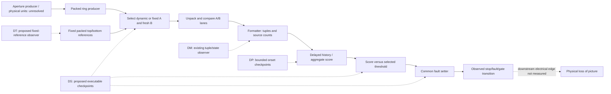

# Instrumented controller-fault checkpoint

This additive report preserves the completed observations from the custom DM
record reader and DP onset recorder. It does not replace their immutable raw
captures, independently checked reports or earlier rejected attempts. The
coordinator alone performs target operations; all parallel agents are host-only.

## What actually executed

The zero-vendor DO probe diagnosed a lexical sysfs alias error in our own
managed USB binding guard. Native GETDRIVER and filesystem device/inode checks
subsequently qualified the owned usbfs claim. The independently reviewed DM and
DP helpers use that evidence and separate exclusive receipt files from runtime
GC output. Neither helper modifies controller RAM or code. They are custom
observers of existing RAM state, not installed controller breakpoints.

DM record-baseline-01 completed twelve fixed read pairs on USB58. DP
score-baseline-01 then performed the matched Apps/header/one-Left trial at the
unchanged alternate limit40. It accepted five clean cycles and a sixth-cycle
fault, with48headers/96bulks, release, close and exact cleanup. Before any UI
recovery, DM record-fault-01 retained the record arrays in twelve further exact
read pairs. Separate normal Apps selection and one bounded stock MODE2 request
completed afterward. The controller enumerated as USB59, on the same Linux boot.
DM recovered-clean-01 subsequently read a clean state and actual alternate
limit40. No threshold write, instruction patch, persistent hook or flash executed.

## Narrower fault evidence

DP clean checkpoint scores were0,0,0,0,38; the postfault score was42. The
software state changed from stop0/fault0/gate1 to stop1/fault0x1001/gate0.
The conservative last-clean-to-first-fault read bracket was249541microseconds.
Last-clean history[0,4,0,4] and source-count4 changed to history[4,0,4,0] with
current source-count0. This is compatible with delayed accumulation; it does
not reveal every intervening dispatch. C7 became1 before the sequential
publication mirror changed from200 to40, illustrating why sampled context
does not prove the decision-time branch.

The later DM snapshot retained a source-compatible prefix of41records sharing
row-like value2159 and channel-like metadata0. Repeated x values were570/571,
622/623,624/625 and632/633. All41 B values were below500 and their unsigned
differences exceeded500. Conditional on the same type1 epoch and12-bit inputs,
the only amplitude candidates B+Diff were1861,550,3052 and1718 respectively.
Those values repeat by x despite varying B. This narrows the reference-input
question but does not establish a physical pixel/color mapping, the damaged
line as cause, or fixed versus dynamic A selection. The arrays were captured
47.089546seconds after DP ended; they cannot be backdated to the first fault.

DR source work establishes that fixed reference buffers use four packed12-bit
lanes per6bytes, with no8-byte header at their fixed bases. The initially
considered linear-u16 windows were misindexed and were never sent to the TV.
New bounded read-only windows are being qualified from the packed layout.

## Why the proposed limit experiment is still held

The unchanged frozen DQ writer would reject the recovered clean profile:
R+0x20 and R+0xbc are3161 rather than3183, R+0x98 is24 rather than25, and
R+0xac is254 rather than251. Its native M upper-bound check would also fail.
The first pair are real B-band qualification inputs, not padding. The parent
created set-04-readiness and normal Apps/header preparation, but did not invoke
DQ. The next step is source qualification of these differences or continued
read-only investigation; no guard is silently weakened or made a wildcard.

## Remaining blind spots and next instrumentation

The current readers sample sequential state and can miss intermediate changes.
They do not retain the actual selected A pointer/header at comparison time,
the complete producer epoch, a call trace into the common setter, or the final
electrical light/rail transition. No physical picture was verified during the
unattended captures. Fixed-reference reads may test whether retained amplitudes
match a later buffer; such a match alone cannot prove its historical use.
An independent executable-RAM hook feasibility audit is addressing exact
registers, event fields, storage ownership, cache coherency and rollback before
any controller instruction modification is considered. Boot/network recovery
remain required constraints.

## Reproducible evidence

- DP/live-baseline-analysis:208explicit checks in normal and Python-O runs;
  inventory8c640f445e2e42768628dd4936db71801721e19b3bf58d9436b49e8236f7934c.
- DM/live-baseline-analysis:213checks each; inventory2243581a958099bb70ae22808f946ac9be0c75d0c21d817428a6f98e3d827857.
- DM/live-fault-analysis:264checks each; inventory86b7d10c91279e5a424e3af46dd650cd2f50682c8d8e62530b3a2dc7bd2538a1.
- All original receipts, raw byte files, per-pair brackets, strict parsers and
  hashes remain in their capture directories. Short identifiers above are
  navigation aids, not integrity checks.

These results identify a reproducible controller software fault path more
precisely. They do not establish a permanent prevention fix or optical recovery.
