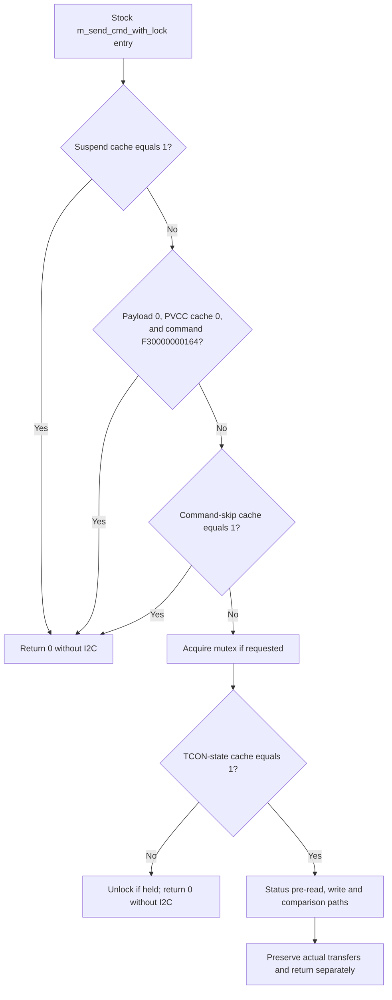

# Exact QD command-gate reference

This is an offline reference for interpreting a future trace, not a bypass
procedure. It combines the independently checked transport and lifecycle reports.
All packed command comparisons below use the full value, not only a selector.

## Write-helper decision order

Logging branches omitted from this compact graph do not alter its gate order.
Passing entry gates does not guarantee write emission: later transport/retry
paths and concurrent state changes still matter. Conversely an observed write
constrains the gate checks on the attributed route, not the flag values for the
whole transfer or surrounding interval.

## Read-helper behavior differs

| Helper / gate | Return on suppression | Caller output | Exception |
| --- | --- | --- | --- |
| Locking read, suspend1 | 0 | untouched | none |
| Locking read, command-skip1 | 0 | untouched | exact `0xf3800000000c` passes this gate |
| Locking read, TCON-state not1 | -1 | untouched | exact `0xf38000000000` passes this gate |
| No-lock read, suspend1 | 0 | untouched | none |
| No-lock read, command-skip1 | 0 | untouched | none |
| No-lock read, TCON-state not1 | 0 | untouched | none |

Passing one exception does not bypass the other gates. A cached or initialized
caller value must not be called a fresh controller readback. A real Linux I2C
transfer likewise does not establish vendor acknowledgement or emitted light.

## Provenance and limits

- [Transport branches and raw evidence](qd-command-transport-failure.md)
- [Command-skip lifecycle](qd-command-skip-lifecycle.md)
- [Suspend/state lifecycle](qd-suspend-state-lifecycle.md)
- [PVCC guard lifecycle](qd-unmute-pvcc-guard.md)
- [Mute writers](qd-mute-writer-map.md) and [mutex ordering](qd-mute-concurrency.md)
- [Retained evidence constraints](../overnight/qd-gate-evidence-constraints.md)

The special PVCC-zero skip remains unconstrained by the retained power-query
exchange. No direct live RAM flag values or initiating physical blackout edge
were acquired, and no gate was forced or patched.
