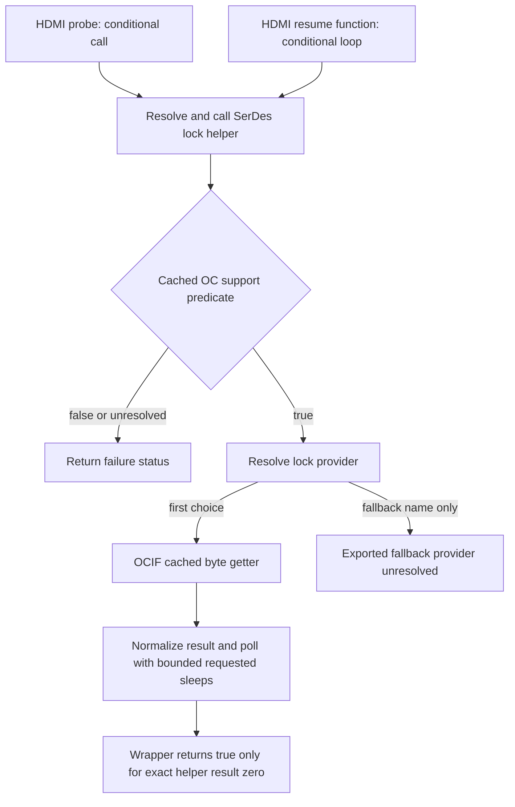

# SerDes lock helper: positive probe/resume callers, not a diagnosed blackout timer

The newly copied modules resolve an additional kernel path: HDMI probe and resume code can dynamically call a SerDes lock helper that requests up to 300 ten-millisecond sleeps per invocation. This is a concrete lifecycle lead. It is not proof that this code ran at the owner's menu blackout, that three seconds is a panel-off deadline, or that bypassing the wait would repair the damaged panel.

No function in this report was invoked for diagnosis. Acquisition consisted of finite ordinary file/metadata reads, and analysis was offline. The physical screen remained unobserved. No firmware, kernel, factory configuration, GPIO, register, power-management policy or output state was changed.

## Exact source identity and acquisition

The [bounded discovery](../overnight/serdes-symbol-discovery-20261026/client-stdout.json) scanned 67 files in two fixed module directories. Its 26 matches across 15 files are byte-substring occurrences only. They are not all definitions or callable exports. The two selected missing modules were copied in fixed 32 KiB chunks with authenticated target/UID, unchanged boot, before/after whole-file hashes, per-chunk bounds and final byte/hash checks. Independent review reconstructed both saved files exactly from the raw responses.

| Module | Bytes / SHA-256 |
|---|---|
| Previously copied `sdp_hdmi.ko` | `f7cffd19934ef459b0263ceddddf003306b399e01d0ddee48df3f64a86667994` |
| Newly copied `tztv-battery.ko` | 174,902 / `dd7e9c1c68b3802e8e8fc04a9097c2cc6baaedd5960e7a25bb387499edbc2270` |
| Newly copied `system_drv.ko` | 46,510 / `fbe4eaad57c66865e2cc50b575a878a690c06303905e666e75b9f08d139dd1f0` |
| Newly copied `sdp_ocl.ko` | 261,166 / `80b9e66f4129a31207f1eee8d7636d7565193ecf9ba87e3bded6196c5e1b02e7` |

[Support copy](../overnight/serdes-support-copy-20261026/manifest.json) used two chunks, uptime `65148.84..65148.98`. [OCIF copy](../overnight/serdes-ocif-copy-20261026/manifest.json) used eight chunks, uptime `65149.18..65150.28`. Boot was `00000000-0000-4000-8000-000000000000`; both copies are sequential/non-atomic and establish on-disk bytes, not live kernel memory or function binding. The capture commands did not load or call the modules.

## Reconstructed path



All offsets below include their ELF section. A numeric offset without its section is insufficient to identify a function or call site.

### HDMI dynamic wrapper and its callers

`sdp_hrx_is_ocl_serdes_locked`, `sdp_hdmi.ko:.text+0x4cad0`, size 132, uses a callback cache at module `.bss+0x1700`. On a cold lookup it resolves literal `tztv_system_serdes_lock_check` (`.rodata.str1.8+0x1f740`) via `__symbol_get` at `0x4cb10`, stores the pointer at `0x4cb14`, calls it, then uses `__symbol_put` at `0x4cb28`. The warm path invokes the stored pointer directly. Both return a boolean true only if the callback result is exactly zero. Missing lookup logs and returns false through a local `-22` value.

The direct relocation-backed caller sites are:

- `.text.unlikely+0x13b8`, inside `sdp_hdmi_probe` (`.text.unlikely+0x53c`, size 4948). The shown branch is conditional on a field at instance/context `+0x60`; the result participates in initialization logic.
- `.text+0x4cd4`, inside `sdp_hdmi_resume_fxn` (`.text+0x48f8`, size 1380). The path requires a nonnull resume argument and a nonzero byte reached through `[context+0x18]+0x60`. It calls the wrapper and loops on a false low-byte result at `0x4cd8/0x4cdc`. A separate counter/threshold branch can also exit the loop. The counter's physical clock calibration and the whole path's elapsed-time bound are not established here.

`sdp_hdmi_pm_resume` directly calls `sdp_hdmi_resume_fxn` at `.text+0x4f84`; `sdp_hdmi_resume` does so at `.text+0x5444`. Thus a positive resume-phase caller exists. It remains necessary to trace the stock registration/dispatch routes and align an actual invocation with the physical event. A function named resume does not prove the TV performed a system suspend, module reload, reset or reboot.

**Review correction:** an early agent attribution confused `.text+0x4cd4` with the same numeric offset in `.text.unlikely`, incorrectly placing the second call in an AUX-message routine. Parent checked the relocation section and enclosing symbol, rejected that attribution, and the agent withdrew it. The AUX interpretation is not retained as a hypothesis.

### Poll helper and return conventions

`tztv_system_serdes_lock_check`, `tztv-battery.ko:.text+0x8d60`, size 308, first lazily resolves `tztv_sys_is_oc_support` into the table at `.bss+0x218`, slot `+0x10`. Missing support symbol returns `-16`; a zero support predicate returns `-19`.

When support is nonzero, `_get_serdes_lock_symbol.constprop.0` at `.text+0x8c78` tries `sdp_ocif_lock_get` first and `sdp_serdes_lock` second. The selected provider pointer and its normalization wrapper occupy table slots `+0` and `+8`.

- OCIF normalization at `.text+0x8c20` treats a provider result **greater than zero** as success zero. Zero or negative becomes failure.
- Fallback normalization at `.text+0x8be8` treats provider result **exactly zero** as success; nonzero becomes failure.

The poll initializes a counter to 300 at `0x8d94`, invokes the normalized provider if available, decrements the counter and requests `msleep(10)` at `0x8dbc/0x8dc0`. It continues while the normalized result is nonzero and attempts remain. Even the success iteration includes a sleep. If lookup is unresolved it can retry resolution through the loop.

This permits up to 300 requested ten-millisecond sleeps per helper invocation, with callback/scheduler overhead. **It is not an exact three-second timeout for the full HDMI caller**, which can repeat the helper and has separate logic. The helper itself does not contain a panel-off or module-reboot action.

### Newly resolved providers are different kinds of state

`system_drv.ko:tztv_sys_is_oc_support` is `.text+0xdc0`, size 40. It computes a boolean from bytes in its own `.bss+0xa8` state: the high nibble of byte `+3` must be zero and byte `+1` must equal four. This analysis has not captured those live bytes or proven which board-identity initialization supplied them.

`sdp_ocl.ko:sdp_ocif_lock_get`, `.text+0x90`, size 28, returns a cached byte at `[global instance+0xb8]`, or `-1` if the global pointer is null. It does not itself sample a hardware link register. The producer and freshness of that cached byte remain to be traced. Its positive value must not be labeled measured link health without that provenance.

There is also a global function named `sdp_serdes_lock` in this copied `sdp_ocl.ko`, `.text+0x49c8`, size 160. Its body uses `read_u32` with literal address `0x05450370` and tests mask `0x100e` across ten iterations. Failure paths log and return `-1`; completing the successful read/check loop returns zero. **This function is not exported by the copied module**: its kernel export table/string has no `sdp_serdes_lock` entry. It therefore does not establish the target of the helper's dynamic fallback lookup. It is an unlinked same-named implementation candidate; another exporter or a built-in target remains unproven. Neither this function nor its read was called.

Independent review caught this distinction before the report was frozen. The first-choice `sdp_ocif_lock_get`, support predicate and poll helper do have exact kernel export entries; the reproducer now checks them and the fallback export absence, as well as both resolver-call relocations. A defined first-choice export still does not prove a successful runtime binding or that the fallback never executes. The HDMI cold wrapper retains its pointer after releasing the acquired symbol reference, so the static cache alone also cannot establish pointer lifetime or current validity.

## New available observation route, not yet enabled

A finite read-only [format capture](../overnight/pm-tracepoint-formats-20261026/client-stdout.json), uptime `65493.04..65493.05`, confirmed six existing kernel events:

- `power/device_pm_callback_start`: device, driver, parent, PM operation label and event.
- `power/device_pm_callback_end`: device, driver and signed error.
- `power/suspend_resume`: action, value and begin/end.
- `rpm/rpm_resume`, `rpm/rpm_suspend`: device name, flags and PM counters/state fields.
- `rpm/rpm_return_int`: device name, IP and signed return.

The target ended that metadata read with global tracing `0`, tracer `nop`; no event was enabled by the command. The raw response SHA-256 is `451feb2a78782bbcc7373afb54b21a835b5ba5529efa9bbcb4a3cddc8e962ce9`.

Upstream Linux 5.4 brackets framework PM callbacks with start/end events, while runtime PM has separate event definitions and return traces. These are framework reference semantics, not proof of every vendor call site in this Samsung build. See the primary [PM callback code](https://github.com/torvalds/linux/blob/v5.4/drivers/base/power/main.c), [runtime PM code](https://github.com/torvalds/linux/blob/v5.4/drivers/base/power/runtime.c) and [RPM event definitions](https://github.com/torvalds/linux/blob/v5.4/include/trace/events/rpm.h).

A future separately reviewed observer extension can record positive PM activity and timing around a physical edge. It must preserve the accepted observer, existing START..END window, source/process/FD/trace guards and separate physical annotations, with new resource and parser checks. **Direct vendor resume calls or private dispatch may bypass framework events.** Their absence cannot prove that no resume/reset occurred. The six format files alone establish availability and field layout, not effective incident coverage.

## Reproduction and unresolved requirements

[Exact-module helper](serdes-lock-path-reproduce.py), SHA-256 `0e4938a237a9e300075a2ea16d01f35b5dd74371816cb2bb22c3732615d67087`; [saved disassembly](serdes-lock-path.disasm), SHA-256 `57c53384b576de1f6d49a2ba4932b0e919c6a4061b7ceb16fe66806f4f6fdaf7`. It hash-pins the source reader and four modules, verifies section-aware symbols/landmarks/relocations/literals and export distinctions, and compares the full saved excerpts. It has no TV or network action:

```sh
PYTHONPATH=/tmp/tcon-capstone python3 serdes-lock-path-reproduce.py
```

Manual CFG/dataflow review remains necessary. The next useful edges are the OCIF cached-byte producer, actual runtime binding and the stock HDMI resume dispatch/registration route. None of this establishes an incident-aligned SerDes failure, explains sparse-menu dependence, repairs impact damage, proves permanent prevention or recovers a latched black panel. The physical-onset capture remains decisive.
